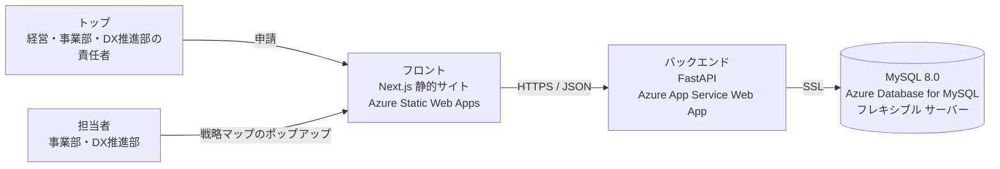
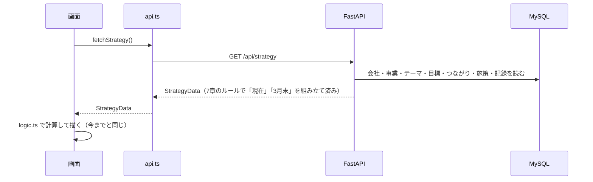
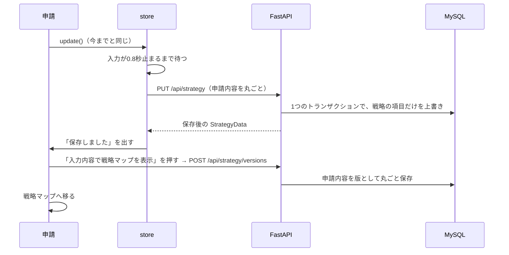
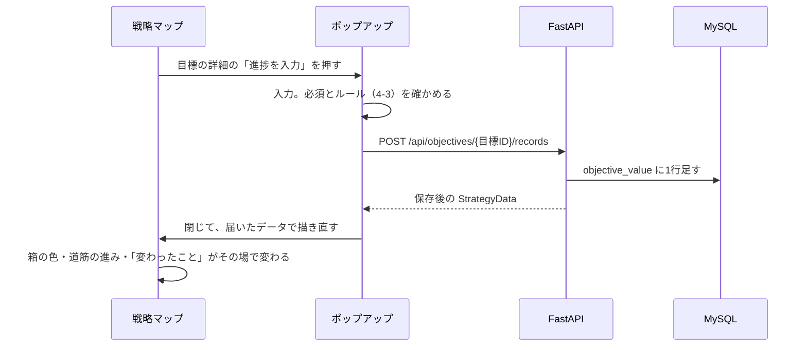
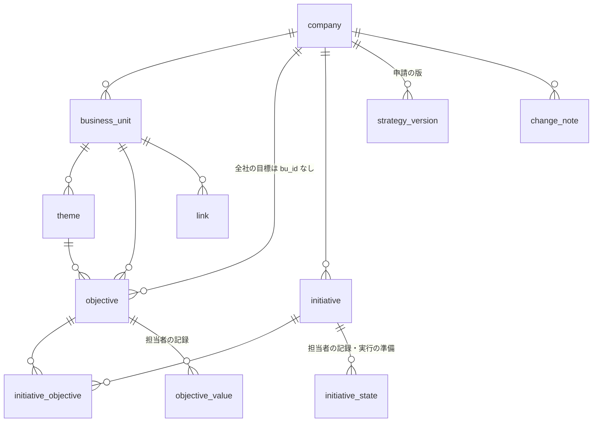

# ミチスジ　システム設計書 v0.1

2026-11-19　作成：服部

この文書は、ミチスジを「画面だけ」から「画面＋バックエンド＋DB」にするためのシステムの設計書です。どの画面で誰が何を入力し、それがどのAPIでバックエンドに届き、DBのどこに保存され、どう返ってきて画面に出るかを書きます。

申請の質問の中身（BSC・IPAに沿った問いの立て方）は `ミチスジ_戦略マップ・申請書_設計書_v0.4_20261115.md` のとおりで、この文書では変えません。変えるのは「どの項目を、どの画面で、誰が入力するか」の割り振りだけです。

---

## 0. 前提と、この版で決めたこと

### 0-1 前提

- 今回はMVP（最終発表のデモ用）。本番運用はしない
- 会社は1社だけ（架空の「みらい精機株式会社」）。ログインはなし（将来はGビズID連携の想定）
- 他社比較・参加企業の集計に出る値は、今回は初期データを返すだけで、計算はしない
- 画面の計算（指標の動き、道筋の進み、DXの段階）は、今までどおりフロントの `logic.ts` で行う。バックエンドは計算しない

### 0-2 この版で決めたこと

1. **入力を2つの層に分ける**
   - 申請＝経営・事業部・DX推進部のトップが、戦略を新しく描く・描き直す場
   - 戦略マップ＝事業部・DX推進部の担当者が、上が決めた戦略に沿って「何をやったか」と「その結果どうなったか」を記録する場
2. 担当者の入力は、戦略マップの右の詳細にボタンを置き、ポップアップで入力する
3. 担当者の入力は**上書きせず、記録として積み上げる**。戦略マップの「現在／2026年3月末」は、この記録から組み立てる
4. トップが申請を保存すると、戦略は上書きする。そのうえで「入力内容で戦略マップを表示」を押した時点の申請内容を、**版として丸ごと残す**

### 0-3 確認してほしいこと

| No | 内容 | この版での案 |
|---|---|---|
| Q1 | 施策の「実行の準備」（実行条件の確保、検証と次の判断日の決定）と「決めた場」は、トップ側（申請）か担当者側か | **トップ側**に残す。予算・工数・権限を確保し判断日を決めるのは、上の判断なので |
| Q2 | 施策の指標（指標名・基準値・目標値）を入力する欄が、今の申請にない（ダミーデータにだけある） | 申請のステップ4の施策の表に足す。今の値は担当者が入れる |
| Q3 | 申請から「今」と「実行・検証」を外すと、登録した直後は指標が「未測定」、施策が「検討中」から始まる | それでよい（登録したあと、担当者が最初の値を入れて動き出す） |

---

## 1. 全体の構成



| 部分 | 技術 | Azureのリソース | プラン |
|---|---|---|---|
| フロント | Next.js 16（静的エクスポート）＋TypeScript | Static Web Apps（`wonderful-bush-0251b4200`） | Free |
| バックエンド | Python 3.12、FastAPI、SQLAlchemy 2.0、PyMySQL | App Service Web App（Linux） | Free F1（発表当日だけB1に上げてよい） |
| DB | MySQL 8.0、文字コード utf8mb4 | Database for MySQL フレキシブル サーバー | Burstable B1ms、20GiB |

### 1-1 設定値（環境変数）

| 置き場所 | 名前 | 中身 |
|---|---|---|
| Web App のアプリ設定 | `DB_HOST` `DB_PORT` `DB_NAME` `DB_USER` `DB_PASSWORD` | MySQLの接続情報 |
| 同上 | `CORS_ORIGINS` | フロントのURL（カンマ区切りで複数可。手元確認用に `http://localhost:3000` も足す） |
| 同上 | `COMPANY_ID` | 表示する会社のID（今回は `1`） |
| フロントのビルド時 | `NEXT_PUBLIC_API_BASE_URL` | バックエンドのURL。静的エクスポートなので**ビルドのときに埋め込まれる**。GitHub Actions の設定に書く |

---

## 2. 入力の役割分担（どこで・誰が・何を）

### 2-1 申請（トップ）で入力するもの

戦略の中身すべて。項目は設計書v0.4のステップ0〜8のまま。

| ステップ | 入力する項目 | 保存先（8章） |
|---|---|---|
| 0 会社と事業 | 全社の財務目標（目標・指標・基準・目標・期限）、対象にする事業（事業名・業種・売上割合・責任者） | `objective`（全社）、`business_unit` |
| 1 財務の目標 | 今との差、差の埋め方、事業の財務目標（目標・種類・指標・基準・目標・期限） | `business_unit`、`objective` |
| 2 顧客への価値 | 対象の顧客、顧客価値提案の類型、将来の提供価値、顧客の成果目標 | `business_unit`、`objective` |
| 3 戦略テーマと業務 | 戦略テーマ（1〜3個）、変える業務（目標・テーマ・主担当・協働・指標…）、事業側で確認した人・日付 | `theme`、`objective`、`business_unit` |
| 4 必要な力と施策 | 学習と成長の目標、施策（施策名・付ける目標・主担当・デジタル・IPA項目・**施策の指標名・基準・目標**＝Q2） | `objective`、`initiative`、`initiative_objective` |
| 5 つながりと検証 | 元の目標→先の目標、理由（仮説）、成り立つ条件、次に確かめること、時期 | `link` |
| 6 実行の準備 | 実行条件の確保、検証と次の判断日、決めた場（＝Q1） | `initiative`、`initiative_state` |
| 7・8 | 入力なし（確認だけ） | — |

### 2-2 戦略マップ（担当者）で入力するもの

| どこから | 入力する項目 | 必須 | 保存先 |
|---|---|---|---|
| **目標**の詳細 →「進捗を入力」 | 測った日 | ○ | `objective_value` |
| | 指標の今の値 | ○ | 同上 |
| | 動かなかった・下がった理由（設計書v0.4 U-3の5択：施策が遅れた／施策は進んだが指標が動かない／外部環境が変わった／測れていない／その他） | 横ばい・悪化のときだけ○ | 同上 |
| | メモ | | 同上 |
| | 入力した人 | ○ | 同上 |
| **施策**の詳細 →「やったことを記録」 | やった日（期間の終わり） | ○ | `initiative_state` |
| | やったこと（打ち手を、どういうふうにやったか） | ○ | 同上 |
| | 結果・わかったこと | | 同上 |
| | 実行の状態（検討中／試行中／実行中／中止） | ○ | 同上 |
| | 効果の検証（未測定／確認中／効果あり／効果なし。試行中・実行中のときだけ） | ○ | 同上 |
| | 施策の指標の今の値（指標があるときだけ） | | 同上 |
| | 入力した人 | ○ | 同上 |

### 2-3 申請から外すもの・申請に足すもの

| 変更 | 対象 | 理由 |
|---|---|---|
| 外す | ステップ0〜4の指標の表の「今」の列 | 担当者の入力（2-2）へ移すため。基準値は申請時点の値として残す |
| 外す | ステップ4の施策の表の「実行」「検証」の列 | 担当者の入力（2-2）へ移すため |
| 足す | ステップ4の施策の表に「施策の指標・基準・目標」（Q2） | 戦略マップの施策の詳細に出ているのに、入力する場所がないため |
| 足す | 各表の「＋追加」「削除」ボタン（事業、財務の目標、顧客の成果目標、戦略テーマ、変える業務、学習と成長の目標、施策） | 今の申請は、初期データの行を書き換えることしかできない（増やせるのは「つながり」だけ）。トップが戦略を新しく描いたり、外部環境に合わせて描き直したりするには、目標や施策を増やし・外せる必要があるため。戦略テーマは1〜3個の範囲でだけ増やせる |

申請の問いの並び・説明文（ヒント）・選択肢は変えない。

---

## 3. 画面ごとの処理の流れ

### 3-1 画面を開いたとき（4画面共通）



- 他社と比べる：さらに `GET /api/peers`
- 参加企業の集計：さらに `GET /api/meti/summary`
- 読み込み中は今までどおり何も出さない（`StoreProvider` がデータが届くまで中身を出さない）。読み込みに失敗したときは「データを読み込めませんでした（再読み込み）」を出す

### 3-2 申請で入力したとき（トップ）



- 今は1文字ごとに保存しているが、APIにしたら、入力が止まってから保存する（0.8秒）
- PUTで送った中に担当者の項目（今の値、実行・検証など）が入っていても、**バックエンドは無視する**。トップの保存で担当者の記録が消えないようにするため
- 保存に失敗したら「保存できませんでした」を出し、次の入力のときにもう一度送る

### 3-3 戦略マップで記録したとき（担当者）



施策の「やったことを記録」も同じ流れ（`POST /api/initiatives/{施策ID}/records` → `initiative_state` に1行足す）。

---

## 4. 戦略マップの記録のポップアップ（画面）

### 4-1 ボタンの位置

| 詳細 | ボタン | 置き場所 | 出さないとき |
|---|---|---|---|
| 目標（全社の目標も含む） | 進捗を入力 | 「指標」の見出しの右 | 指標が未設定のとき／「2026年3月末」を表示中のとき |
| 施策 | やったことを記録 | 「状態」の見出しの右 | 「2026年3月末」を表示中のとき |

過去の時点は見るだけにする。

### 4-2 詳細に足す表示

| 詳細 | 足す見出し | 中身 |
|---|---|---|
| 目標 | 値の記録 | 新しい順に最大5件：測った日、値、理由（あれば）、メモ、入力した人。6件目からは「すべて見る」で開く |
| 施策 | やったこと | 新しい順に最大5件：日付、やったこと、結果・わかったこと、実行の状態の変化（例：試行中→実行中）、入力した人 |

### 4-3 ポップアップのルール

- 開くと、今の値・今の状態が最初から入っている。日付は今日
- 目標：保存する前に、入力した値で `indState` を計算する。「横ばい」「悪化」なら理由の選択を必須にする
- 施策：実行の状態が「検討中」「中止」のときは、効果の検証を「未測定」に固定して選べなくする（`running()` と同じ考え）
- 保存中はボタンを押せなくする。失敗したら、ポップアップを閉じずにエラーを出す
- 「やめる」「×」「Esc」で閉じる。入力途中なら「入力を捨てますか」を確認する

### 4-4 部品

| 部品 | ファイル（新規） |
|---|---|
| ポップアップの枠 | `src/components/Modal.tsx` |
| 目標の進捗入力 | `src/features/map/ObjectiveRecordModal.tsx` |
| 施策のやったことの記録 | `src/features/map/InitiativeRecordModal.tsx` |

---

## 5. 申請画面の変更

| ファイル | 変更 |
|---|---|
| `features/entry/forms.tsx` | `KPI_KEYS` から `cur` を外す（指標・基準・目標・期限の4列）。ステップ4の施策の表から「実行」「検証」を外し、「施策の指標・基準・目標」を足す。各表に「＋追加」「削除」を足す |
| `features/entry/EntryView.tsx` | 保存の状態（保存中／保存しました／保存できませんでした）を右上に出す。「入力内容で戦略マップを表示」で版を保存してから移る |
| `lib/store.tsx` | 保存を0.8秒まとめる。サーバーから届いたデータで置き換える `replace()` を足す（置き換えたときはPUTしない） |

### 5-1 行を足すときのID

- 新しい行のIDはフロントで作る（例：目標 `o_` ＋ランダム8文字、施策 `i_`、テーマ `t_`、事業 `b_`）
- 申請内容を丸ごとPUTする作りなので、IDが先に決まっていないと、どの行が新しいか分からないため

### 5-2 削除したとき

- DBからは消さず、削除した印（`deleted_at`）を付ける。画面とAPIには出さない
- 理由：設計書v0.4のU-5「中止も履歴に残す」。担当者の記録が付いた目標・施策を消しても、記録は残る
- 目標を消したら、その目標に付くつながりと、施策の「付ける目標」からも外す（フロントで外してから送る）

---

## 6. API設計

### 6-1 共通

| 項目 | 内容 |
|---|---|
| URL | `https://<Web Appの既定ドメイン>/api/...` |
| 形式 | JSON（UTF-8）。項目名は**フロントの型（`types.ts`）と同じ名前**（`buId` ではなく今の `id` `persp` `objs` など） |
| 会社 | 環境変数 `COMPANY_ID` の会社に固定（URLに会社IDは入れない） |
| 認証 | なし（MVP） |
| CORS | `CORS_ORIGINS` に書いたURLだけ許す（FastAPIの `CORSMiddleware`） |
| エラー | `{"detail": "日本語の説明"}`。入力の誤りは422、IDが見つからないときは404、DBの障害は500 |
| 同時に直したとき | 後から保存した方が勝つ（MVP） |

### 6-2 一覧

| No | メソッド・パス | 使う画面 | 内容 |
|---|---|---|---|
| A-1 | `GET /api/health` | （監視用） | DBにつながるか。`{"status":"ok"}` |
| A-2 | `GET /api/strategy` | 4画面すべて | 申請内容と記録を、画面の形（`StrategyData`）で返す |
| A-3 | `PUT /api/strategy` | 申請 | 戦略の項目を丸ごと保存して、保存後の `StrategyData` を返す |
| A-4 | `POST /api/strategy/versions` | 申請 | 今の申請内容を版として保存。`{"id":12,"savedAt":"2026-11-19T16:00:00+09:00"}` |
| A-5 | `POST /api/objectives/{id}/records` | 戦略マップ | 目標の進捗の記録を1件足して、`StrategyData` を返す |
| A-6 | `POST /api/initiatives/{id}/records` | 戦略マップ | 施策のやったことの記録を1件足して、`StrategyData` を返す |
| A-7 | `GET /api/peers` | 他社と比べる | `PeerData`（初期データのまま） |
| A-8 | `GET /api/meti/summary` | 参加企業の集計 | `MetiData`（初期データのまま） |

記録を足したAPIが `StrategyData` を丸ごと返すのは、道筋の進みやDXの段階が、1つの値で事業全体に響くため。画面は届いたもので描き直すだけにする。

### 6-3 A-2 の返す形（`StrategyData`）

今の `types.ts` の形に、**記録の一覧だけを足す**（足すだけなので、今の画面はそのまま動く）。

```ts
/** 目標の進捗の記録（新規） */
export interface ValueRecord {
  at: string;          // 測った日 "2026-11-19"
  value: string;       // "月42件"
  reason: number | null; // U-3の番号（0〜4）。なければ null
  memo: string;
  author: string;
}
/** 施策のやったことの記録（新規） */
export interface ActivityRecord {
  at: string;
  did: string;
  result: string;
  exec: number;
  verify: number;
  kpiCur?: string;
  author: string;
}
// Objective に  history?: ValueRecord[]   を足す（新しい順）
// Initiative に history?: ActivityRecord[] を足す（新しい順）
```

`prev`（2026年3月末）、`cur`（現在）、`exec` `verify` `checks`、`diffs` は、7章のルールでバックエンドが記録から組み立てて入れる。

### 6-4 A-3 PUT /api/strategy

- 受け取る：`StrategyData`（申請で持っている形そのまま）
- 使う項目：2-1の項目だけ
- **無視する項目**：目標の `cur` `prev` `history`、施策の `exec` `verify` `cur` `prev` `history`、`diffs`、`company`（会社の情報は申請では入力しないため）
- 処理（1つのトランザクション）
  1. 事業・テーマ・目標・施策：送られてきた行は、あれば上書き、なければ追加。DBにあって送られてこなかった行は `deleted_at` を付ける
  2. つながり：事業ごとに、全部消して入れ直す（つながりにはIDがないため）
  3. 施策と目標の紐づけ：施策ごとに入れ直す
  4. 実行の準備（`checks`）が今と違う施策・新しい施策：`initiative_state` に1行足す（実行の状態・検証は直前の記録を引き継ぐ。新しい施策は「検討中」「未測定」。`source='entry'`）
- 確かめること（違えば422）：視点・主担当・資本の種類などが決まった値か／つながり・紐づけ・テーマが、同じ会社の消していない行を指しているか／戦略テーマが事業ごとに1〜3個か

### 6-5 A-5 POST /api/objectives/{id}/records

```json
{ "at": "2026-11-19", "value": "月48件", "reason": null, "memo": "提案ルールを全拠点に展開", "author": "産業機器事業部 田中" }
```

- `value` `at` `author` は必須。`reason` は0〜4か null
- 横ばい・悪化のとき理由を必須にするのは画面で確かめる（バックエンドは数値の読み取りをしないため）

### 6-6 A-6 POST /api/initiatives/{id}/records

```json
{ "at": "2026-11-19", "did": "連携対象を組立ラインの全設備に広げ、欠損の監視を自動化した", "result": "欠損なし率が91%→95%", "exec": 2, "verify": 1, "kpiCur": "2,300台", "author": "DX推進部 佐藤" }
```

- `at` `did` `exec` `verify` `author` は必須。`exec` は0〜3、`verify` は0〜3
- `exec` が0（検討中）・3（中止）なら `verify` は0にそろえて保存する
- 実行の準備（`checks`）は送らない。直前の記録の値を引き継ぐ

---

## 7. 「現在」と「2026年3月末」の組み立て方

戦略マップの時点の切り替えと、他社比較の白抜きの点（3月末の位置）は、今は初期データの `prev` で出している。これを記録から組み立てる。

| 返す項目 | 組み立て方 |
|---|---|
| 目標の `cur` | その目標の `objective_value` のうち、いちばん新しい値（測った日→登録順） |
| 目標の `prev` | 測った日が**前回の時点**（`company.snapshot_at`、今回は 2026-03-31）以前の記録のうち、いちばん新しい値。なければ入れない |
| 施策の `exec` `verify` `checks` | その施策の `initiative_state` のうち、いちばん新しい行 |
| 施策の `cur`（施策の指標の今の値） | `kpi_cur` が入っている行のうち、いちばん新しい値 |
| 施策の `prev` | 前回の時点以前の、いちばん新しい行の `exec` `verify` `checks`。なければ入れない |
| `diffs`（2026年3月末から変わったこと） | ①前回の時点より後の、担当者の記録から作る文（新しい順）。目標は「{目標名}：{指標名} {前の値} → {今の値}（{測った日}）」、施策は「{施策名}：{やったこと}（{日付}）」。②そのあとに `change_note`（初期データの文）を並べる |

画面に出す「2026年3月末」という文字は、今回は画面に書いたままにする（`snapshot_at` に合わせて変えるのは次の段階）。

---

## 8. DB設計

### 8-1 テーブルのつながり



- どのテーブルも MySQL 8.0、InnoDB、`utf8mb4` / `utf8mb4_0900_ai_ci`
- 事業・テーマ・目標・施策のIDは、画面のID（`B1` `T1` `b1lg1` `i1` など）を文字のまま使い、`(company_id, id)` を主キーにする
- 指標の値は画面と同じく「月42件」のように**単位つきの文字**で持つ（計算はフロントの `num()` で行うため）
- 番号で持つ選択肢（CVP、HZ、EXEC、VERIFY、IPA、FINKIND、U-3の理由）は、フロントの `constants.ts` の番号をそのまま使う。DBに選択肢の表は作らない（MVP）

### 8-2 戦略（トップが申請で入力）

**company（会社）**

| 列 | 型 | 内容 |
|---|---|---|
| id | INT 自動採番 PK | |
| name | VARCHAR(100) | 企業名 |
| industry | VARCHAR(100) | 業種 |
| snapshot_at | DATE | 前回の時点（比較の基準日）。今回は 2026-03-31 |
| created_at / updated_at | DATETIME | |

**business_unit（事業）**

| 列 | 型 | 内容 |
|---|---|---|
| company_id | INT PK・FK | |
| id | VARCHAR(40) PK | 画面のID |
| name / industry | VARCHAR(100) | 事業名・業種 |
| share | TINYINT | 全社売上に占める割合（%） |
| owner_name | VARCHAR(100) | 責任者 |
| cvp | TINYINT | 顧客価値提案の類型（CVPの番号） |
| customer / future | TEXT | 対象の顧客、将来の提供価値 |
| gap | VARCHAR(200) | 今との差 |
| growth | TINYINT | 収益増大で埋める割合（%） |
| conf_by / conf_at | VARCHAR(100) / DATE NULL | 事業側で確認した人・日付 |
| sort_order | INT | 並び順 |
| deleted_at | DATETIME NULL | 削除した印 |

**theme（戦略テーマ）**：company_id・id（PK）、bu_id（FK）、name VARCHAR(200)、hz TINYINT、sort_order、deleted_at

**objective（目標）**

| 列 | 型 | 内容 |
|---|---|---|
| company_id / id | PK | |
| bu_id | VARCHAR(40) NULL | NULLなら全社の目標 |
| persp | ENUM('lg','pr','cu','fi') | BSCの視点 |
| name | VARCHAR(200) | 目標名 |
| kpi | VARCHAR(200) | 指標名（空なら指標が未設定） |
| base / target / due | VARCHAR(100) | 基準値・目標値・期限（**基準値は上書きしない**。記録は `objective_value` へ） |
| owner | ENUM('biz','dx','mgmt') | 主担当 |
| partner | VARCHAR(100) | 協働 |
| theme_id | VARCHAR(40) NULL | 戦略テーマ（財務の目標は持たない） |
| cap | ENUM('hum','inf','org') NULL | 学習と成長の資本の種類 |
| fin_kind | TINYINT NULL | 財務の目標の種類（FINKINDの番号） |
| sort_order / deleted_at | | |

**link（目標どうしのつながり）**：id INT 自動採番 PK、company_id、bu_id、from_id・to_id（目標のID）、reason TEXT、cond TEXT、check_text TEXT、check_date VARCHAR(50)、sort_order

**initiative（施策）**

| 列 | 型 | 内容 |
|---|---|---|
| company_id / id | PK | |
| name | VARCHAR(200) | 施策名 |
| owner / partner | ENUM / VARCHAR(100) | 主担当・協働 |
| digital | BOOLEAN | デジタルの施策か |
| ipa | TINYINT NULL | IPAの取組項目（1〜7）。デジタル以外は NULL |
| ev | VARCHAR(300) | 決めた場（会議体・日付・資料） |
| kpi / base / target | VARCHAR(200/100/100) | 施策の指標・基準・目標（Q2） |
| sort_order / deleted_at | | |

**initiative_objective（施策が付く目標）**：company_id・initiative_id・objective_id（PK）、sort_order

### 8-3 記録（担当者が戦略マップで入力。上書きせず足していく）

**objective_value（目標の進捗の記録）**

| 列 | 型 | 内容 |
|---|---|---|
| id | BIGINT 自動採番 PK | |
| company_id / objective_id | FK | |
| at | DATE | 測った日 |
| value | VARCHAR(100) | 指標の値 |
| reason | TINYINT NULL | 動かなかった・下がった理由（U-3の番号） |
| memo | TEXT | |
| source | ENUM('seed','map') | 初期データか、戦略マップからか |
| author | VARCHAR(100) | 入力した人 |
| created_at | DATETIME | 登録した時刻 |

索引：`(company_id, objective_id, at)`

**initiative_state（施策の状態とやったことの記録）**

| 列 | 型 | 内容 |
|---|---|---|
| id | BIGINT 自動採番 PK | |
| company_id / initiative_id | FK | |
| at | DATE | やった日（申請から作った行は保存した日） |
| exec / verify | TINYINT | 実行の状態・効果の検証 |
| chk_condition / chk_review | BOOLEAN | 実行の準備（トップが申請で入力） |
| kpi_cur | VARCHAR(100) NULL | 施策の指標の今の値 |
| did / result | TEXT NULL | やったこと、結果・わかったこと |
| source | ENUM('seed','entry','map') | 初期データ／申請（実行の準備の変更）／戦略マップ |
| author | VARCHAR(100) | |
| created_at | DATETIME | |

索引：`(company_id, initiative_id, at)`

状態（実行・検証）と実行の準備を1つの表にまとめたのは、時点ごとの施策の状態（`InitState`）を1行で組み立てられるようにするため。

### 8-4 その他

**strategy_version（申請の版）**：id BIGINT 自動採番 PK、company_id、saved_at DATETIME、body JSON（A-4を呼んだ時点の `StrategyData`）

**change_note（初期データの「変わったこと」）**：id、company_id、noted_at DATE、text VARCHAR(500)、sort_order

**reference_data（他社比較・集計の初期データ）**：key VARCHAR(40) PK（`peers` / `meti`）、body JSON、updated_at

---

## 9. 初期データ

`frontend/src/mocks/seed.ts` の中身をDBに入れる。

| seed.ts | 入れる先 |
|---|---|
| `company` | `company`（id=1、snapshot_at=2026-03-31） |
| `corp.fin` | `objective`（bu_id なし） |
| `bus` → 事業・テーマ・目標・つながり | `business_unit`、`theme`、`objective`、`link` |
| 目標の `prev` / `cur` | `objective_value` に2行（at=2026-03-31／2026-11-01、source='seed'）。`prev` がない目標は `cur` の1行だけ |
| `inits` | `initiative`、`initiative_objective` |
| 施策の `prev` / 今の状態 | `initiative_state` に2行（同じ日付の考え方）。今の状態の行に `kpi_cur` |
| `diffs` | `change_note` |
| `seedPeers` / `seedMeti` | `reference_data` |

手順：`seed.ts` をJSONに書き出す小さなスクリプト（Node）→ バックエンドの `python -m app.seed` がそのJSONを読んでDBに入れる。手元のPCからAzureのMySQLにつないで1回だけ流す（MySQLのネットワークで手元のIPを許可済みのため）。入れ終わったら `src/mocks` はフロントから消す。

---

## 10. バックエンドの作り

```
backend/
├─ app/
│  ├─ main.py         FastAPIの起動、CORS、ルーターの登録
│  ├─ config.py       環境変数の読み込み
│  ├─ db.py           MySQLへの接続（SSL。証明書は certifi を使う）
│  ├─ models.py       テーブルの定義（SQLAlchemy）
│  ├─ schemas.py      APIの入出力の形（Pydantic。types.ts と同じ項目名）
│  ├─ strategy.py     StrategyData の組み立て（7章）と保存（6-4）
│  ├─ routers/        strategy.py / records.py / reference.py / health.py
│  └─ seed.py         初期データの投入
├─ sql/schema.sql     テーブルを作るSQL
├─ requirements.txt   fastapi, uvicorn, gunicorn, sqlalchemy, pymysql, certifi, pydantic-settings
└─ .env.example       手元で動かすときの設定の見本（本物の .env は Git に入れない）
```

- Web App の起動コマンド：`gunicorn -w 2 -k uvicorn.workers.UvicornWorker --bind 0.0.0.0:8000 app.main:app`
- 手元で動かす：`uvicorn app.main:app --reload`（http://localhost:8000/docs でAPIを試せる）

---

## 11. デプロイ

| 対象 | 方法 |
|---|---|
| バックエンド | GitHub Actions を新しく1本（`.github/workflows/backend.yml`）。`main` に `backend/` の変更がpushされたら、Web Appへデプロイ（`azure/webapps-deploy`、発行プロファイルを GitHub の Secrets に登録） |
| フロント | 今の Static Web Apps のワークフローに、ビルド時の環境変数 `NEXT_PUBLIC_API_BASE_URL` を足すだけ |
| DB | テーブル作成（`schema.sql`）と初期データ（9章）を手元から1回流す |

発行プロファイルを使うため、Web App の「構成」→「全般設定」で「SCM 基本認証の発行資格情報」をオンにしてから、「発行プロファイルのダウンロード」をする。

---

## 12. フロントで変わるファイルの一覧

| ファイル | 変更 |
|---|---|
| `lib/api.ts` | 4つの関数の中身をAPI呼び出しに。`addObjectiveRecord()` `addInitiativeRecord()` `saveVersion()` を足す |
| `lib/types.ts` | `ValueRecord` `ActivityRecord` と、`history` を足す |
| `lib/store.tsx` | 保存を0.8秒まとめる、`replace()`、保存の状態 |
| `features/entry/forms.tsx` `EntryView.tsx` | 5章 |
| `features/map/Panel.tsx` | ボタンと記録の一覧（4-1・4-2） |
| `features/map/ObjectiveRecordModal.tsx` `InitiativeRecordModal.tsx` `components/Modal.tsx` | 新規（4章） |
| `src/mocks/` | 初期データをDBに入れたら消す |

他社と比べる・参加企業の集計・`logic.ts` は変えない。

---

## 13. 今回やらないこと（次の段階）

- ログインと、トップ・担当者の権限分け（今回は誰でも両方の画面で入力できる）
- 複数社。他社比較・参加企業の集計を、DBの実データから計算すること
- 前回の時点（2026年3月末）を、更新のたびに切り替えること。画面の「2026年3月末」の文字を `snapshot_at` に合わせること
- 申請の版どうしを並べて比べる画面
- つながり（仮説）を確かめた結果の記録（設計書v0.4 U-4）。今回は施策の「やったこと・結果」に書く
- 同時に直したときの衝突の検知
