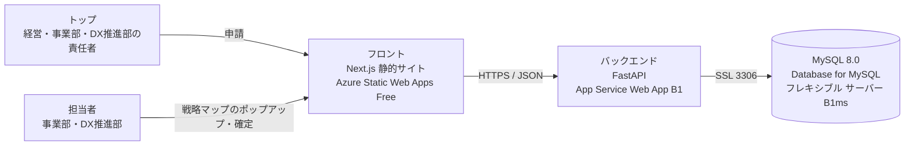
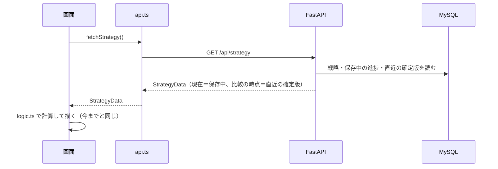
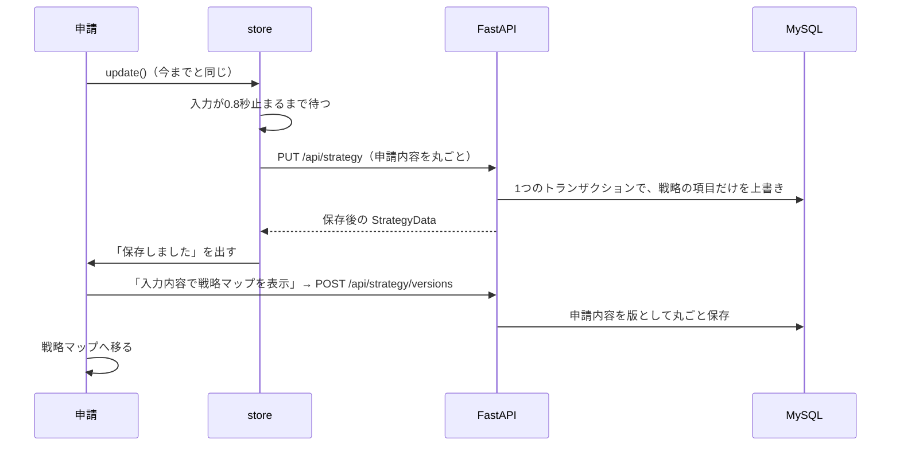
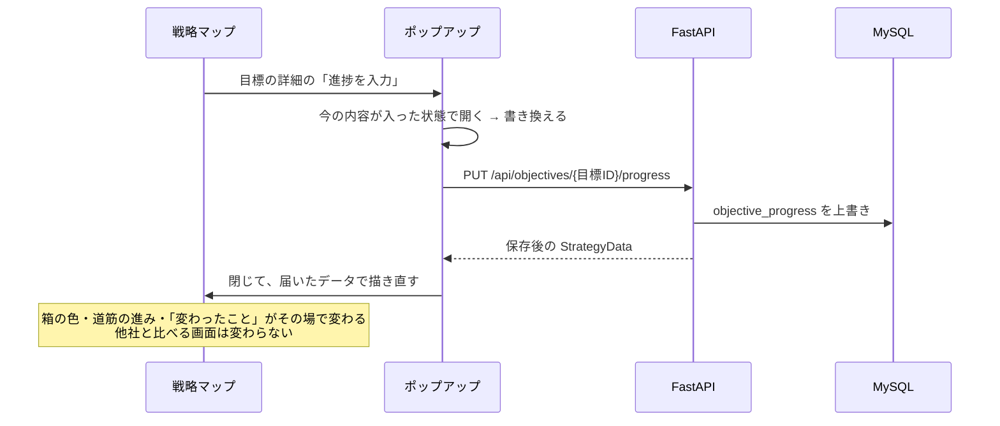
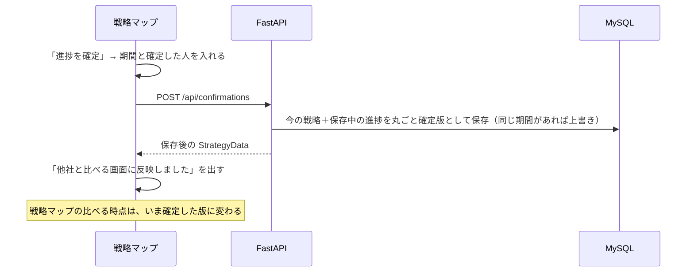
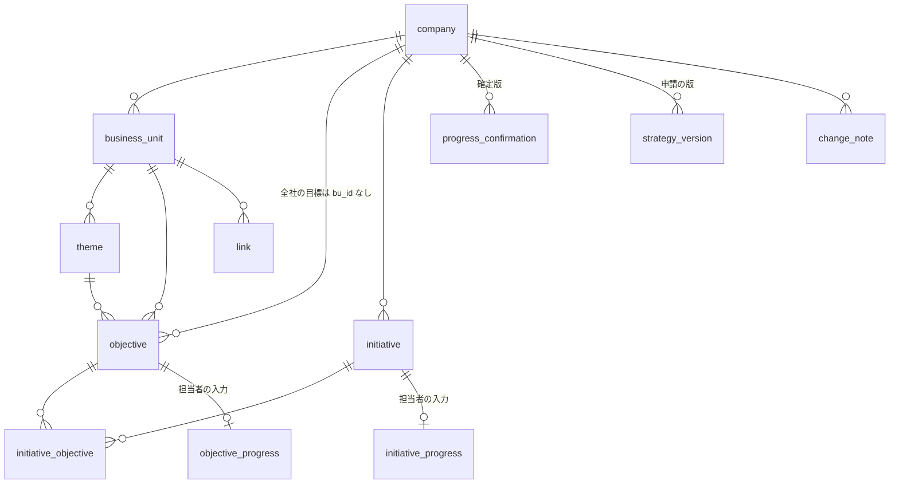

# ミチスジ　システム設計書 v0.3

2026-11-19　作成：服部

この文書は、ミチスジを「画面だけ」から「画面＋バックエンド＋DB」にするためのシステムの設計書です。どの画面で誰が何を入力し、それがどのAPIでバックエンドに届き、DBのどこに保存され、どう返ってきて画面に出るかを書きます。Azureの各リソースの作り方と設定値もここに書きます。

申請の質問の中身（BSC・IPAに沿った問いの立て方）は `ミチスジ_戦略マップ・申請書_設計書_v0.4_20261115.md` のとおりで、この文書では変えません。変えるのは「どの項目を、どの画面で、誰が入力するか」の割り振りだけです。

---

## 0. 前提と、この版で決めたこと

### 0-1 前提

- 今回はMVP（最終発表のデモ用）。本番運用はしない
- 会社は1社だけ（架空の「テクゼロン株式会社」）。ログインはなし（将来はGビズID連携の想定）
- 他社の点・参加企業の集計に出る値は、今回は初期データを返すだけで、計算はしない
- 画面の計算（指標の動き、道筋の進み、DXの段階）は、今までどおりフロントの `logic.ts` で行う。バックエンドは計算しない

### 0-2 この版で決めたこと

1. **入力を2つの層に分ける**
   - 申請＝経営・事業部・DX推進部のトップが、戦略を新しく描く・描き直す場
   - 戦略マップ＝事業部・DX推進部の担当者が、上が決めた戦略に沿って「何をやったか」と「その結果どうなったか」を入力する場
2. 担当者の入力は、戦略マップの右の詳細に置いたボタンからポップアップで行う。**いつでも書き換えられる**（前に入れた内容を上書きする）。MVPなので、何かあったらすぐ直せることを優先する
3. **進捗の「保存」と「確定」を分ける**
   - 保存：担当者がふだん入力するもの。戦略マップにはすぐ出る。他社と比べる画面には出ない
   - 確定：四半期・半年ごとに、その時点の進捗を「確定版」として残す。他社と比べる画面のグラフは、確定版だけで描く（入力のたびに点が動かないようにするため）
   - 本来は確定版は書き換えられないものだが、今回は**同じ期間をもう一度確定すると上書きできる**ようにする
   - 確定版は何個でも足せる。他社と比べる画面では、確定版ごとに自社の点が1つずつ増え、事業ごとの**軌跡**として見える
   - 展示（ポスターセッション）で来場者が触れるように、確定版の**削除**と、**デモを初期状態に戻す**ボタンを付ける（今回だけの機能）
4. トップが申請を保存すると、戦略は上書きする。そのうえで「入力内容で戦略マップを表示」を押した時点の申請内容を、版として丸ごと残す

### 0-3 確認してほしいこと

| No | 内容 | この版での案 |
|---|---|---|
| Q1 | 施策の「実行の準備」（実行条件の確保、検証と次の判断日の決定）と「決めた場」は、トップ側（申請）か担当者側か | **トップ側**に残す。予算・工数・権限を確保し判断日を決めるのは、上の判断なので |
| Q2 | 施策の指標（指標名・基準値・目標値）を入力する欄が、今の申請にない（ダミーデータにだけある） | 申請のステップ4の施策の表に足す。今の値は担当者が入れる |
| Q3 | 申請から「今」と「実行・検証」を外すと、登録した直後は指標が「未測定」、施策が「検討中」から始まる | それでよい（登録したあと、担当者が最初の値を入れて動き出す） |
| Q4 | 初期データの確定版をどうするか | 「2026年3月末」の確定版を1つだけ入れる。いまのダミーの「現在」の値は、確定前の保存として入れる。デモは「戦略マップで進捗を入力 → 確定 → 他社と比べる画面に点が増える」を何回でも繰り返せる流れにする（7-3） |

---

## 1. 全体の構成と、Azureの設定

### 1-1 構成



| 部分 | 技術 | Azureのリソース | プラン |
|---|---|---|---|
| フロント | Next.js 16（静的エクスポート）＋TypeScript | Static Web Apps | **Free** |
| バックエンド | Python 3.12、FastAPI、SQLAlchemy 2.0、PyMySQL | App Service（Web App、Linux） | **Basic B1** |
| DB | MySQL 8.0、文字コード utf8mb4 | Database for MySQL フレキシブル サーバー | **Burstable B1ms、20GiB** |

リソースグループは1つにまとめる。地域は Web App と MySQL を **Japan East** にそろえる（Static Web Apps は世界中から配信されるので地域の影響はない）。

### 1-2 プランを選んだ理由

| リソース | 選んだもの | 理由 |
|---|---|---|
| Static Web Apps | Free | 置くのは画面のファイルだけで、サーバーの処理がない。CPUの上限もない。Freeの上限は転送量が月100GB・1アプリ250MBで、デモの規模ではまず届かない |
| Web App | B1 | Free（F1）はCPU時間が1日60分・5分ごとに2.5分までで、超えると止まる（403）。発表前日・当日に止まるのを避けるため。B1はCPUの上限がなく、Always On（起動待ちなし）も使える。時間単位の課金なので、発表後にF1に戻すか削除すれば止まる |
| MySQL | Burstable B1ms、20GiB | いちばん小さい構成。高可用性・geo冗長はオフ |
| 関数（Azure Functions）にしなかった理由 | — | 無料分は大きいが、久しぶりのアクセスで起動待ちが出ることがあり、FastAPIを関数の作りに合わせ直す作業とデプロイ確認が増えるため |

### 1-3 フロント：Static Web Apps（作成済み）

| 項目 | 設定値 |
|---|---|
| 名前 | `wonderful-bush-0251b4200`（作成済み） |
| プラン | Free |
| ソース | GitHub `nishiyan-12-tech0/yonayona-B-dash`、ブランチ `main` |
| ビルドの設定（ワークフロー） | `app_location: "/frontend"`、`output_location: "out"`、`api_location: ""` |
| 追加する設定 | ワークフローの「Build And Deploy」に環境変数 `NEXT_PUBLIC_API_BASE_URL: https://<Web Appの既定ドメイン>` を足す。静的エクスポートなので、**ビルドのときにこの値が画面に埋め込まれる**（ポータルのアプリ設定ではなく、ワークフローに書く） |
| URL | `https://wonderful-bush-0251b4200.<番号>.azurestaticapps.net`（ポータルの「概要」で確認。Web Appの `CORS_ORIGINS` に入れる） |

### 1-4 バックエンド：App Service（Web App）

**作るとき（ポータル：App Service →「＋作成」→「Web アプリ」）**

| タブ | 項目 | 設定値 |
|---|---|---|
| 基本 | リソースグループ | フロントと同じ |
| | 名前 | `michisuji-api`（一意の既定のホスト名はオンのまま） |
| | 公開 | コード |
| | ランタイムスタック | Python 3.12 |
| | OS | Linux |
| | 地域 | Japan East |
| | Linux プラン | 新規作成 `michisuji-plan` |
| | 価格プラン | **Basic B1** |
| | ゾーン冗長 | 無効 |
| デプロイ | 継続的デプロイ | 無効（あとで GitHub Actions を自分で足す。11章） |
| ネットワーク | パブリックアクセス | オン |
| 監視 | Application Insights | いいえ |

**作ったあと（Web App の左メニュー）**

| 場所 | 項目 | 設定値 |
|---|---|---|
| 設定 → 構成 → 全般設定 | スタートアップ コマンド | `gunicorn -w 2 -k uvicorn.workers.UvicornWorker --bind 0.0.0.0:8000 --chdir backend app.main:app` |
| 同上 | Always On | オン |
| 同上 | SCM 基本認証の発行資格情報 | オン（発行プロファイルでデプロイするため） |
| 同上 | FTP 基本認証の発行資格情報 | オフ |
| 同上 | HTTPS のみ | オン |
| 同上 | 最小 TLS バージョン | 1.2 |
| 設定 → 環境変数 → アプリ設定 | 下の表 | |
| 監視 → 正常性チェック | パス | `/api/health` |
| API → CORS | （**触らない**） | CORSはFastAPI側で設定する。両方に入れるとぶつかる |

**アプリ設定（環境変数）**

| 名前 | 値 |
|---|---|
| `DB_HOST` | `michisuji-db.mysql.database.azure.com` |
| `DB_PORT` | `3306` |
| `DB_NAME` | `michisuji` |
| `DB_USER` | MySQLの管理者ユーザー名（例 `michisuji_admin`） |
| `DB_PASSWORD` | MySQLのパスワード |
| `CORS_ORIGINS` | `https://wonderful-bush-0251b4200.<番号>.azurestaticapps.net,http://localhost:3000` |
| `COMPANY_ID` | `1` |
| `SCM_DO_BUILD_DURING_DEPLOYMENT` | `true`（デプロイ時に `requirements.txt` からライブラリを入れる） |

### 1-5 DB：Database for MySQL フレキシブル サーバー

**作るとき（ポータル：Azure Database for MySQL フレキシブル サーバー →「＋作成」）**

| タブ | 項目 | 設定値 |
|---|---|---|
| 基本 | リソースグループ | フロントと同じ |
| | サーバー名 | `michisuji-db` |
| | 地域 | Japan East（Web Appと同じ） |
| | MySQL のバージョン | 8.0 |
| | ワークロードの種類 | 開発用または趣味のプロジェクト |
| | コンピューティングとストレージ | バースト可能（Burstable）`Standard_B1ms`（1仮想コア・2GiB） |
| | ストレージ サイズ | 20 GiB |
| | ストレージの自動拡張 | オフ |
| | IOPS | 事前プロビジョニング（自動スケールはオフ） |
| | 可用性ゾーン | 指定なし |
| | 高可用性 | オフ |
| | バックアップの保持期間 | 7日（初期値）。**用意したストレージ（20GiB）の分までは追加料金なし** |
| | geo 冗長バックアップ | オフ（ここは料金が上がる） |
| | 認証方法 | MySQL 認証のみ |
| | 管理者ユーザー名・パスワード | 例 `michisuji_admin`。パスワードは控えて Web App のアプリ設定へ |
| ネットワーク | 接続方法 | パブリック アクセス（許可された IP アドレス） |
| | ☑ Azure 内の任意の Azure サービスにこのサーバーへのパブリック アクセスを許可する | オン（Web Appからつなぐため） |
| | ファイアウォール規則 | 「＋現在のクライアント IP アドレスを追加」（手元のPCからテーブル作成・初期データ投入をするため） |

**作ったあと**

| 場所 | 項目 | 設定値 |
|---|---|---|
| 設定 → データベース | ＋追加 | 名前 `michisuji`、文字セット `utf8mb4`、照合順序 `utf8mb4_0900_ai_ci` |
| 設定 → サーバー パラメーター | `require_secure_transport` | ON（初期値のまま。バックエンドはSSLでつなぐ） |
| 同上 | `time_zone` | `+09:00`（任意。バックエンドは日本時間で時刻を入れる） |

### 1-6 料金と、発表後の止め方

| リソース | 料金の考え方 | 発表後 |
|---|---|---|
| Static Web Apps Free | 無料 | そのまま |
| Web App B1 | 時間単位の課金（米国東部で月13.14ドルの目安。数日なら1〜2ドル程度） | 「スケールアップ」でF1に戻すか、削除 |
| MySQL B1ms | 計算（時間単位）＋ストレージ20GiB。バックアップは20GiBまで追加料金なし。Azure無料アカウントなら12か月・月750時間まで無料 | 「停止」で計算の料金が止まる（ストレージ分は残る） |

正確な金額は Azure の料金計算ツールで Japan East を選んで確認する。

---

## 2. 入力の役割分担（どこで・誰が・何を）

### 2-1 申請（トップ）で入力するもの

戦略の中身すべて。項目は設計書v0.4のステップ0〜8のまま。

| ステップ | 入力する項目 | 保存先（8章） |
|---|---|---|
| 0 会社と事業 | 全社の財務目標（目標・指標・基準・目標・期限）、対象にする事業（事業名・業種・売上割合・責任者） | `objective`（全社）、`business_unit` |
| 1 財務の目標 | 今との差、差の埋め方、事業の財務目標（目標・種類・指標・基準・目標・期限） | `business_unit`、`objective` |
| 2 顧客への価値 | 対象の顧客、顧客価値提案の類型、将来の提供価値、顧客の成果目標 | `business_unit`、`objective` |
| 3 戦略テーマと業務 | 戦略テーマ（1〜3個）、変える業務（目標・テーマ・主担当・協働・指標…）、事業側で確認した人・日付 | `theme`、`objective`、`business_unit` |
| 4 必要な力と施策 | 学習と成長の目標、施策（施策名・付ける目標・主担当・デジタル・IPA項目・**施策の指標名・基準・目標**＝Q2） | `objective`、`initiative`、`initiative_objective` |
| 5 つながりと検証 | 元の目標→先の目標、理由（仮説）、成り立つ条件、次に確かめること、時期 | `link` |
| 6 実行の準備 | 実行条件の確保、検証と次の判断日、決めた場（＝Q1） | `initiative` |
| 7・8 | 入力なし（確認だけ） | — |

### 2-2 戦略マップ（担当者）で入力するもの

どれも**上書き**。何度でも書き換えられる。

| どこから | 入力する項目 | 必須 | 保存先 |
|---|---|---|---|
| **目標**の詳細 →「進捗を入力」 | 指標の今の値 | ○ | `objective_progress` |
| | 測った日 | ○ | 同上 |
| | 動かなかった・下がった理由（設計書v0.4 U-3の5択：施策が遅れた／施策は進んだが指標が動かない／外部環境が変わった／測れていない／その他） | 横ばい・悪化のときだけ○ | 同上 |
| | メモ | | 同上 |
| | 入力した人 | ○ | 同上 |
| **施策**の詳細 →「進捗を入力」 | 実行の状態（検討中／試行中／実行中／中止） | ○ | `initiative_progress` |
| | 効果の検証（未測定／確認中／効果あり／効果なし。試行中・実行中のときだけ） | ○ | 同上 |
| | やったこと（打ち手を、どういうふうにやったか） | ○ | 同上 |
| | 結果・わかったこと | | 同上 |
| | 施策の指標の今の値（指標があるときだけ） | | 同上 |
| | 入力した人 | ○ | 同上 |
| **戦略マップの上部** →「進捗を確定」 | 確定する期間（例：2026年9月末） | ○ | `progress_confirmation` |
| | 確定した人 | ○ | 同上 |

「やったこと」「結果」は、確定と確定のあいだ（今の期間）の内容を書く。期間ごとの記録は確定版に残る。

### 2-3 申請から外すもの・申請に足すもの

| 変更 | 対象 | 理由 |
|---|---|---|
| 外す | ステップ0〜4の指標の表の「今」の列 | 担当者の入力（2-2）へ移すため。基準値は申請時点の値として残す |
| 外す | ステップ4の施策の表の「実行」「検証」の列 | 担当者の入力（2-2）へ移すため |
| 足す | ステップ4の施策の表に「施策の指標・基準・目標」（Q2） | 戦略マップの施策の詳細に出ているのに、入力する場所がないため |
| 足す | 各表の「＋追加」「削除」ボタン（事業、財務の目標、顧客の成果目標、戦略テーマ、変える業務、学習と成長の目標、施策） | 今の申請は、初期データの行を書き換えることしかできない（増やせるのは「つながり」だけ）。トップが戦略を新しく描いたり、外部環境に合わせて描き直したりするには、目標や施策を増やし・外せる必要があるため。戦略テーマは1〜3個の範囲でだけ増やせる |

申請の問いの並び・説明文（ヒント）・選択肢は変えない。

---

## 3. 画面ごとの処理の流れ

### 3-1 画面を開いたとき



| 画面 | 呼ぶAPI | 「現在」に出るもの | 比べる時点に出るもの |
|---|---|---|---|
| 申請 | `GET /api/strategy` | — | — |
| 戦略マップ | `GET /api/strategy` | 保存中の進捗 | 直近の確定版 |
| 他社と比べる | `GET /api/strategy/confirmed` と `GET /api/peers` | **直近の確定版** | それより前の確定版（新しい順に最大5つ。軌跡として出す。4-7） |
| 参加企業の集計 | `GET /api/meti/summary` | 初期データ | — |

- 読み込み中は今までどおり何も出さない。失敗したときは「データを読み込めませんでした（再読み込み）」を出す

### 3-2 申請で入力したとき（トップ）



- 今は1文字ごとに保存しているが、APIにしたら、入力が止まってから保存する（0.8秒）
- PUTで送った中に担当者の項目（今の値、実行・検証など）が入っていても、**バックエンドは無視する**。トップの保存で担当者の入力が消えないようにするため
- 保存に失敗したら「保存できませんでした」を出し、次の入力のときにもう一度送る

### 3-3 戦略マップで進捗を入力したとき（担当者・保存）



施策も同じ流れ（`PUT /api/initiatives/{施策ID}/progress` → `initiative_progress` を上書き）。

### 3-4 進捗を確定したとき



---

## 4. 戦略マップの画面の変更

### 4-1 ボタンの位置

| 場所 | ボタン | 出さないとき |
|---|---|---|
| 目標の詳細（全社の目標も含む）の「指標」の見出しの右 | 進捗を入力 | 指標が未設定のとき／比べる時点を表示中のとき |
| 施策の詳細の「状態」の見出しの右 | 進捗を入力 | 比べる時点を表示中のとき |
| 戦略マップの上部（時点の切り替えの右） | 進捗を確定 | 比べる時点を表示中のとき |

比べる時点（過去）を表示中は見るだけにする。

### 4-2 詳細に足す表示

| 詳細 | 足す表示 |
|---|---|
| 目標 | 指標の下に「最終更新：{測った日}　{入力した人}」。理由・メモがあれば出す |
| 施策 | 「状態」の下に「今の期間にやったこと」「結果・わかったこと」と「最終更新：{日付}　{入力した人}」 |

### 4-3 進捗を入力するポップアップ

- 開くと、今の内容が最初から入っている（なければ空。日付は今日）
- 目標：保存する前に、入力した値で `indState` を計算する。「横ばい」「悪化」なら理由の選択を必須にする
- 施策：実行の状態が「検討中」「中止」のときは、効果の検証を「未測定」に固定して選べなくする（`running()` と同じ考え）
- 保存中はボタンを押せなくする。失敗したら、ポップアップを閉じずにエラーを出す
- 「やめる」「×」「Esc」で閉じる。書きかけなら「入力を捨てますか」を確認する

### 4-4 進捗を確定するポップアップ

| 項目 | 内容 |
|---|---|
| 説明文 | 「今の進捗を確定版として残し、他社と比べる画面に反映します。ふだんの保存は他社と比べる画面には出ません。」 |
| 確定する期間 | 年と、四半期の末（3月末／6月末／9月末／12月末）を選ぶ。初期値は今日の直前の四半期の末 |
| 確定した人 | 文字で入れる |
| 確定済みの一覧 | 期間・確定した日・確定した人（新しい順）。各行に「削除」（初期データの「2026年3月末」は出発点なので消せない） |
| 同じ期間がすでにあるとき | 「{期間}の確定版を上書きします」と出してから確定する（今回だけの扱い。本来は上書きしない） |
| 確定したあと | 「他社と比べる画面に反映しました」と、「他社と比べる」へのリンクを出す。前の確定版から点の位置が変わらなかった事業があれば「{事業名}は前回の確定から位置が変わっていません」と添える（指標が動かないと点も動かないことが、触った人に分かるように） |
| 初期状態に戻す | 一覧の下に「デモを初期状態に戻す」。確かめてから、確定版・進捗・申請の内容を初期データに戻す（A-13。展示で次の人が触る前に使う） |

### 4-5 時点の切り替えと「変わったこと」

| 今の画面 | 変更後 |
|---|---|
| 時点の切り替え「現在／2026年3月末」 | 「現在／{直近の確定版の期間}」（例：現在／2026年3月末） |
| 「2026年3月末から変わったこと」 | 「{直近の確定版の期間}から変わったこと」。中身は7-2のルールで作る |

### 4-6 部品

| 部品 | ファイル（新規） |
|---|---|
| ポップアップの枠 | `src/components/Modal.tsx` |
| 目標の進捗入力 | `src/features/map/ObjectiveProgressModal.tsx` |
| 施策の進捗入力 | `src/features/map/InitiativeProgressModal.tsx` |
| 進捗の確定・確定版の削除・初期状態に戻す | `src/features/map/ConfirmModal.tsx` |

### 4-7 他社と比べる画面の変更（軌跡）

| 今の画面 | 変更後 |
|---|---|
| 自社の事業ごとに、塗りの点（現在）と白抜きの点（2026年3月末）の2つ | 事業ごとに、確定版の数だけ点を出す（最大6つ）。いちばん新しい確定版が塗りの点、それより前は白抜きの点で、古いほど薄くする。同じ事業の点を、古い順に細い線でつなぐ（軌跡） |
| 白抜き＝2026年3月末 の凡例 | 「塗り＝{直近の確定版の期間}／白抜き＝それより前の確定版」 |
| 点にマウスを乗せたとき | 「{事業名}（{期間}）」 |
| 同じマスに同じ事業の点が重なるとき | 少しずらして出す |
| 項目ごとの比較、道筋にあるDX（7項目の表） | 直近の確定版の値で出す |

他社の点は初期データのまま（増えない）。


---

## 5. 申請画面の変更

| ファイル | 変更 |
|---|---|
| `features/entry/forms.tsx` | `KPI_KEYS` から `cur` を外す（指標・基準・目標・期限の4列）。ステップ4の施策の表から「実行」「検証」を外し、「施策の指標・基準・目標」を足す。各表に「＋追加」「削除」を足す |
| `features/entry/EntryView.tsx` | 保存の状態（保存中／保存しました／保存できませんでした）を右上に出す。「入力内容で戦略マップを表示」で版を保存してから移る |
| `lib/store.tsx` | 保存を0.8秒まとめる。サーバーから届いたデータで置き換える `replace()` を足す（置き換えたときはPUTしない） |

### 5-1 行を足すときのID

- 新しい行のIDはフロントで作る（例：目標 `o_` ＋ランダム8文字、施策 `i_`、テーマ `t_`、事業 `b_`）
- 申請内容を丸ごとPUTする作りなので、IDが先に決まっていないと、どの行が新しいか分からないため

### 5-2 削除したとき

- DBからは消さず、削除した印（`deleted_at`）を付ける。画面とAPIには出さない
- 理由：設計書v0.4のU-5「中止も履歴に残す」。確定版には、消す前の目標・施策がそのまま残る
- 目標を消したら、その目標に付くつながりと、施策の「付ける目標」からも外す（フロントで外してから送る）

---

## 6. API設計

### 6-1 共通

| 項目 | 内容 |
|---|---|
| URL | `https://<Web Appの既定ドメイン>/api/...` |
| 形式 | JSON（UTF-8）。項目名は**フロントの型（`types.ts`）と同じ名前** |
| 会社 | 環境変数 `COMPANY_ID` の会社に固定（URLに会社IDは入れない） |
| 認証 | なし（MVP） |
| CORS | `CORS_ORIGINS` に書いたURLだけ許す（FastAPIの `CORSMiddleware`） |
| エラー | `{"detail": "日本語の説明"}`。入力の誤りは422、IDが見つからないときは404、DBの障害は500 |
| 同時に直したとき | 後から保存した方が勝つ（MVP） |

### 6-2 一覧

| No | メソッド・パス | 使う画面 | 内容 |
|---|---|---|---|
| A-1 | `GET /api/health` | 監視 | DBにつながるか。`{"status":"ok"}` |
| A-2 | `GET /api/strategy` | 申請・戦略マップ | 戦略と保存中の進捗。比べる時点は直近の確定版 |
| A-3 | `PUT /api/strategy` | 申請 | 戦略の項目を丸ごと保存して、保存後の `StrategyData` を返す |
| A-4 | `POST /api/strategy/versions` | 申請 | 今の申請内容を版として保存。`{"id":12,"savedAt":"2026-11-19T16:00:00+09:00"}` |
| A-5 | `PUT /api/objectives/{id}/progress` | 戦略マップ | 目標の進捗を上書きして、`StrategyData` を返す |
| A-6 | `PUT /api/initiatives/{id}/progress` | 戦略マップ | 施策の進捗を上書きして、`StrategyData` を返す |
| A-7 | `GET /api/confirmations` | 戦略マップ（確定のポップアップ） | 確定版の一覧（期間・基準日・確定した日・確定した人） |
| A-8 | `POST /api/confirmations` | 戦略マップ | 今の進捗を確定版にして、`StrategyData` を返す |
| A-9 | `GET /api/strategy/confirmed` | 他社と比べる | 確定版を新しい順に最大6つ。`{"versions":[{"id":3,"label":"2026年9月末","asOf":"2026-09-30","data":StrategyData}, …]}` |
| A-10 | `GET /api/peers` | 他社と比べる | `PeerData`（初期データのまま） |
| A-11 | `GET /api/meti/summary` | 参加企業の集計 | `MetiData`（初期データのまま） |
| A-12 | `DELETE /api/confirmations/{id}` | 戦略マップ（確定のポップアップ） | 確定版を1つ消して、`StrategyData` を返す。初期データの「2026年3月末」は消せない（409） |
| A-13 | `POST /api/demo/reset` | 戦略マップ（確定のポップアップ） | 初期データに戻して、`StrategyData` を返す（今回だけ。9章の `--reset` と同じ処理） |

保存したAPIが `StrategyData` を丸ごと返すのは、道筋の進みやDXの段階が、1つの値で事業全体に響くため。画面は届いたもので描き直すだけにする。

### 6-3 返す形（`StrategyData`）に足すもの

今の `types.ts` の形に足すだけ（足すだけなので、今の画面はそのまま動く）。

```ts
/** 目標の進捗（担当者の入力） */
export interface ObjectiveProgress {
  at: string;            // 測った日 "2026-11-19"
  reason: number | null; // U-3の番号（0〜4）
  memo: string;
  author: string;
  updatedAt: string;
}
/** 施策の進捗（担当者の入力）。実行の状態・検証・今の値は、今までどおり Initiative の exec / verify / cur に入る */
export interface InitiativeProgress {
  did: string;
  result: string;
  author: string;
  updatedAt: string;
}
// Objective に  progress?: ObjectiveProgress   を足す
// Initiative に progress?: InitiativeProgress  を足す
// StrategyData に次を足す
//   snap: { now: string; prev: string | null }   // 時点の名前。例 { now: "現在", prev: "2026年3月末" }
```

| 返す項目 | A-2（戦略マップ） | A-9（他社と比べる）の各 `data` |
|---|---|---|
| 目標の `cur`、施策の `exec` `verify` `cur` | 保存中の進捗 | その確定版の値 |
| 目標の `prev`、施策の `prev` | 直近の確定版の値 | 入れない（軌跡は版を並べて描く） |
| 施策の `checks` | 今の申請の値 | その確定版の値 |
| `snap` | `{now:"現在", prev:"{直近の確定版の期間}"}` | `{now:"{その確定版の期間}", prev:null}` |
| `diffs` | 7-2のルールで作る | 空 |

他社と比べる画面は、届いた版ごとに `logic.ts` で道筋の進み・DXの段階を計算し、その位置に点を置く。

比べる時点の版がないときは、`prev` を入れない（今の画面の決まりどおり、現在と同じ位置に出る）。

### 6-4 A-3 PUT /api/strategy

- 受け取る：`StrategyData`（申請で持っている形そのまま）
- 使う項目：2-1の項目だけ
- **無視する項目**：目標の `cur` `prev` `progress`、施策の `exec` `verify` `cur` `prev` `progress`、`diffs`、`snap`、`company`（会社の情報は申請では入力しないため）
- 処理（1つのトランザクション）
  1. 事業・テーマ・目標・施策：送られてきた行は、あれば上書き、なければ追加。DBにあって送られてこなかった行は `deleted_at` を付ける
  2. つながり：事業ごとに、全部消して入れ直す（つながりにはIDがないため）
  3. 施策と目標の紐づけ：施策ごとに入れ直す
  4. 新しい施策は、進捗を「検討中」「未測定」で作る
- 確かめること（違えば422）：視点・主担当・資本の種類などが決まった値か／戦略テーマが事業ごとに3個以下か（1個以上は画面で守る）
- 参照先がない紐づけ・つながり・テーマ（消した目標を指しているなど）は、エラーにせず保存しない。申請は入力の途中で自動保存するので、途中の状態で保存が止まらないようにするため

### 6-5 A-5 PUT /api/objectives/{id}/progress

```json
{ "value": "月48件", "at": "2026-11-19", "reason": null, "memo": "提案ルールを全拠点に展開", "author": "産業機器事業部 田中" }
```

- `value` `at` `author` は必須。`reason` は0〜4か null
- 横ばい・悪化のときに理由を必須にするのは画面で確かめる（バックエンドは値の数字を読まないため）

### 6-6 A-6 PUT /api/initiatives/{id}/progress

```json
{ "exec": 2, "verify": 1, "kpiCur": "2,300台", "did": "連携対象を組立ラインの全設備に広げ、欠損の監視を自動化した", "result": "欠損なし率が91%→95%", "author": "DX推進部 佐藤" }
```

- `exec` `verify` `did` `author` は必須。`exec` は0〜3、`verify` は0〜3
- `exec` が0（検討中）・3（中止）なら、`verify` は0にそろえて保存する

### 6-7 A-8 POST /api/confirmations

```json
{ "label": "2026年9月末", "asOf": "2026-09-30", "confirmedBy": "DX推進部長" }
```

- その時点の戦略と保存中の進捗で `StrategyData` を組み立て、そのまま確定版として保存する
- 同じ `label` の確定版があれば上書きする（今回だけの扱い）

---

## 7. 時点の扱い（保存と確定）

### 7-1 考え方

| | 保存（ふだん） | 確定（四半期・半年ごと） |
|---|---|---|
| 入れる人 | 担当者 | 担当者（本来は責任者が確認して確定する想定。今回は誰でも押せる。削除・初期状態に戻すも同じ） |
| 書き換え | いつでも上書き | 同じ期間をもう一度確定すると上書き（今回だけ） |
| 出る画面 | 戦略マップ | 他社と比べる（グラフの点）、戦略マップの比べる時点 |
| DB | `objective_progress`、`initiative_progress` | `progress_confirmation`（丸ごと1件） |

確定版には、そのときの戦略（目標・つながり・施策の紐づけ）もいっしょに残す。あとでトップが戦略を描き直しても、過去の確定版の道筋の進みが変わらないようにするため。

### 7-2 「変わったこと」の作り方

戦略マップの「{直近の確定版の期間}から変わったこと」は、保存中の進捗と直近の確定版を比べて、バックエンドが作る（新しい順）。

| 変化 | 出す文 |
|---|---|
| 目標の値が違う | 「{目標名}：{指標名} {確定版の値} → {今の値}」 |
| 施策の実行の状態が違う | 「{施策名}：{確定版の状態} → {今の状態}」 |
| 施策の「やったこと」が入っている | 「{施策名}：{やったこと}」 |

初期データの「変わったこと」（`change_note`）は、直近の確定版が初期データの「2026年3月末」のあいだだけ、上の文のあとに並べる。

### 7-3 初期データとデモの流れ（Q4）

- 初期データの確定版は「2026年3月末」（ダミーデータの `prev` の値）の1つだけ。半年前に最初の申請と進捗を確定した、という想定
- ダミーデータの「現在」の値は、確定前の保存として入れる
- このため、他社と比べる画面の自社の点は、最初は事業ごとに1つ（2026年3月末）だけ
- 発表（約1分）：戦略マップで進捗を入力 → 箱の色・道筋の進みが変わる → 「進捗を確定（2026年9月末）」→ 他社と比べる画面で、自社の点が1つ増えて軌跡になる
- 展示（約30分、来場者も触る）：同じ操作を繰り返し、2026年12月末、2027年3月末…と確定版を足すたびに点が増える。消したいときは確定版を削除、次の人に渡す前は「デモを初期状態に戻す」
- 展示で同時に何人かが触っても、DBは1つなので全員の操作が同じ画面に出る（MVP）

---

## 8. DB設計

### 8-1 テーブルのつながり



- どのテーブルも MySQL 8.0、InnoDB、`utf8mb4` / `utf8mb4_0900_ai_ci`
- 事業・テーマ・目標・施策のIDは、画面のID（`B1` `T1` `b1lg1` `i1` など）を文字のまま使い、`(company_id, id)` を主キーにする
- 指標の値は画面と同じく「月42件」のように**単位つきの文字**で持つ（計算はフロントの `num()` で行うため）
- 番号で持つ選択肢（CVP、HZ、EXEC、VERIFY、IPA、FINKIND、U-3の理由）は、フロントの `constants.ts` の番号をそのまま使う。DBに選択肢の表は作らない（MVP）
- トップの入力（戦略）と担当者の入力（進捗）を別のテーブルに分ける。申請の保存（A-3）は戦略のテーブルだけ、進捗の保存（A-5・A-6）は進捗のテーブルだけを書き換える

### 8-2 戦略（トップが申請で入力）

**company（会社）**

| 列 | 型 | 内容 |
|---|---|---|
| id | INT 自動採番 PK | |
| name | VARCHAR(100) | 企業名 |
| industry | VARCHAR(100) | 業種 |
| created_at / updated_at | DATETIME | |

**business_unit（事業）**

| 列 | 型 | 内容 |
|---|---|---|
| company_id | INT PK・FK | |
| id | VARCHAR(40) PK | 画面のID |
| name / industry | VARCHAR(100) | 事業名・業種 |
| share | TINYINT | 全社売上に占める割合（%） |
| owner_name | VARCHAR(100) | 責任者 |
| cvp | TINYINT | 顧客価値提案の類型（CVPの番号） |
| customer / future | TEXT | 対象の顧客、将来の提供価値 |
| gap | VARCHAR(200) | 今との差 |
| growth | TINYINT | 収益増大で埋める割合（%） |
| conf_by / conf_at | VARCHAR(100) / DATE NULL | 事業側で確認した人・日付 |
| sort_order | INT | 並び順 |
| deleted_at | DATETIME NULL | 削除した印 |

**theme（戦略テーマ）**：company_id・id（PK）、bu_id（FK）、name VARCHAR(200)、hz TINYINT、sort_order、deleted_at

**objective（目標）**

| 列 | 型 | 内容 |
|---|---|---|
| company_id / id | PK | |
| bu_id | VARCHAR(40) NULL | NULLなら全社の目標 |
| persp | ENUM('lg','pr','cu','fi') | BSCの視点 |
| name | VARCHAR(200) | 目標名 |
| kpi | VARCHAR(200) | 指標名（空なら指標が未設定） |
| base / target / due | VARCHAR(100) | 基準値・目標値・期限（今の値は `objective_progress`） |
| owner | ENUM('biz','dx','mgmt') | 主担当 |
| partner | VARCHAR(100) | 協働 |
| theme_id | VARCHAR(40) NULL | 戦略テーマ（財務の目標は持たない） |
| cap | ENUM('hum','inf','org') NULL | 学習と成長の資本の種類 |
| fin_kind | TINYINT NULL | 財務の目標の種類（FINKINDの番号） |
| sort_order / deleted_at | | |

**link（目標どうしのつながり）**：id INT 自動採番 PK、company_id、bu_id、from_id・to_id（目標のID）、reason TEXT、cond TEXT、check_text TEXT、check_date VARCHAR(50)、sort_order

**initiative（施策）**

| 列 | 型 | 内容 |
|---|---|---|
| company_id / id | PK | |
| name | VARCHAR(200) | 施策名 |
| owner / partner | ENUM / VARCHAR(100) | 主担当・協働 |
| digital | BOOLEAN | デジタルの施策か |
| ipa | TINYINT NULL | IPAの取組項目（1〜7）。デジタル以外は NULL |
| ev | VARCHAR(300) | 決めた場（会議体・日付・資料） |
| chk_condition / chk_review | BOOLEAN | 実行の準備（Q1。トップが申請で入力） |
| kpi / base / target | VARCHAR(200/100/100) | 施策の指標・基準・目標（Q2） |
| sort_order / deleted_at | | |

**initiative_objective（施策が付く目標）**：company_id・initiative_id・objective_id（PK）、sort_order

### 8-3 進捗（担当者が戦略マップで入力。上書き）

**objective_progress（目標の進捗）**：目標1つにつき1行

| 列 | 型 | 内容 |
|---|---|---|
| company_id / objective_id | PK・FK | |
| value | VARCHAR(100) | 指標の今の値 |
| at | DATE | 測った日 |
| reason | TINYINT NULL | 動かなかった・下がった理由（U-3の番号） |
| memo | TEXT | |
| author | VARCHAR(100) | 入力した人 |
| updated_at | DATETIME | 最後に保存した時刻 |

**initiative_progress（施策の進捗）**：施策1つにつき1行

| 列 | 型 | 内容 |
|---|---|---|
| company_id / initiative_id | PK・FK | |
| exec / verify | TINYINT | 実行の状態・効果の検証 |
| kpi_cur | VARCHAR(100) NULL | 施策の指標の今の値 |
| did / result | TEXT | 今の期間にやったこと、結果・わかったこと |
| author | VARCHAR(100) | |
| updated_at | DATETIME | |

### 8-4 確定版・その他

**progress_confirmation（確定版）**

| 列 | 型 | 内容 |
|---|---|---|
| id | BIGINT 自動採番 PK | |
| company_id | INT FK | |
| label | VARCHAR(50) | 期間の名前（例：2026年9月末）。`(company_id, label)` で一意 |
| as_of | DATE | 期間の終わりの日（並び順に使う） |
| body | JSON | 確定したときの `StrategyData`（戦略＋進捗を丸ごと） |
| confirmed_by | VARCHAR(100) | 確定した人 |
| confirmed_at | DATETIME | 確定した時刻（上書きしたら新しい時刻） |

丸ごとJSONで持つのは、他社と比べる画面がそのまま `StrategyData` を使って計算するため、また確定後に戦略が描き直されても、その時点の形で残すため。

**strategy_version（申請の版）**：id BIGINT 自動採番 PK、company_id、saved_at DATETIME、body JSON（A-4を呼んだ時点の `StrategyData`）

**change_note（初期データの「変わったこと」）**：id、company_id、confirmation_id（どの確定版からの変化か）、text VARCHAR(500)、sort_order

**reference_data（他社の点・集計の初期データ）**：key VARCHAR(40) PK（`peers` / `meti`）、body JSON、updated_at

---

## 9. 初期データ

`frontend/src/mocks/seed.ts` の中身をDBに入れる。

| seed.ts | 入れる先 |
|---|---|
| `company` | `company`（id=1） |
| `corp.fin` | `objective`（bu_id なし） |
| `bus` → 事業・テーマ・目標・つながり | `business_unit`、`theme`、`objective`、`link` |
| `inits` | `initiative`（`checks` は今の値）、`initiative_objective` |
| 目標の `cur`、施策の `exec` `verify` `cur` | `objective_progress`、`initiative_progress`（確定前の保存） |
| 目標の `prev`、施策の `prev` | `progress_confirmation` に「2026年3月末」（as_of=2026-03-31）を1件。`prev` がない目標・施策は今の値で入れる |
| `diffs` | `change_note`（「2026年3月末」の確定版に付ける） |
| `seedPeers` / `seedMeti` | `reference_data` |

手順：`seed.ts` の中身を `backend/app/seed_data.json` に書き出し済み（会社名はテクゼロン株式会社に変更）。**バックエンドが起動したとき、テーブルがなければ作り、会社のデータがなければ自動で初期データを入れる**ので、手で流す必要はない。`python -m app.seed --reset`、または画面の「デモを初期状態に戻す」で、全部消してから入れ直せる。フロントの `src/mocks` は消した。

---

## 10. バックエンドの作り

```
backend/
├─ app/
│  ├─ main.py         FastAPIの起動、CORS、ルーターの登録
│  ├─ config.py       環境変数の読み込み
│  ├─ db.py           MySQLへの接続（SSL。証明書は certifi を使う）
│  ├─ models.py       テーブルの定義（SQLAlchemy）
│  ├─ schemas.py      APIの入出力の形（Pydantic。types.ts と同じ項目名）
│  ├─ strategy.py     StrategyData の組み立て（6-3・7章）と申請の保存（6-4）
│  ├─ routers/api.py  API（A-1〜A-13）
│  ├─ seed.py         初期データの投入（起動時に自動。--reset あり）
│  └─ seed_data.json  初期データ
├─ sql/schema.sql     テーブルを作るSQL（参考。起動時に自動で作られる）
├─ requirements.txt   fastapi, uvicorn, gunicorn, sqlalchemy, pymysql, certifi, pydantic-settings
└─ .env.example       手元で動かすときの設定の見本（本物の .env は Git に入れない）
```

- 手元で動かす：`uvicorn app.main:app --reload`（http://localhost:8000/docs でAPIを試せる）
- Web App では 1-4 のスタートアップ コマンドで動かす

---

## 11. デプロイ

| 対象 | 方法 |
|---|---|
| バックエンド | Web App の「デプロイ センター」で GitHub のリポジトリ（`main`）につなぐ（リポジトリの持ち主が、自分の GitHub アカウントで設定する。認証は「基本認証」）。デプロイ センターがワークフローと Secrets を自動で作る。リポジトリの一番上でビルドされるので、一番上に `requirements.txt`（中身は `-r backend/requirements.txt`）を置き、起動コマンドに `--chdir backend` を付けて backend/ から動かす |
| フロント | 今の Static Web Apps のワークフローに、`NEXT_PUBLIC_API_BASE_URL` を足すだけ（1-3） |
| DB | 何もしない。バックエンドの初回起動時に、テーブル作成と初期データの投入が自動で行われる（9章） |

確認の順番：①`/api/health` が `ok` を返す → ②`/api/strategy` にダミーデータが出る → ③フロントの4画面が今までどおり出る → ④進捗の入力・確定・申請の保存ができる

---

## 12. フロントで変わるファイルの一覧

| ファイル | 変更 |
|---|---|
| `lib/api.ts` | 関数の中身をAPI呼び出しに。`fetchConfirmedStrategy()` `saveObjectiveProgress()` `saveInitiativeProgress()` `fetchConfirmations()` `confirmProgress()` `saveVersion()` を足す |
| `lib/types.ts` | `ObjectiveProgress` `InitiativeProgress`、`progress`、`snap` を足す |
| `lib/store.tsx` | 保存を0.8秒まとめる、`replace()`、保存の状態 |
| `features/entry/forms.tsx` `EntryView.tsx` | 5章 |
| `features/map/Panel.tsx` `MapView.tsx` | ボタンと表示（4章）。「2026年3月末」の文字を `snap.prev` に |
| `features/map/*Modal.tsx` `components/Modal.tsx` | 新規（4章） |
| `features/compare/CompareView.tsx` | `fetchConfirmedStrategy()` の版ごとに位置を計算して描く（4-7）。凡例の文字を確定版の期間に |
| `components/GridChart.tsx` | 事業ごとに複数の点と、それをつなぐ線を描けるようにする（4-7） |
| `components/Track.tsx` | 「2026年3月末」の文字を `snap.prev` に |
| `src/mocks/` | 初期データをDBに入れたら消す |

参加企業の集計・`logic.ts` は変えない。

---

## 13. 今回やらないこと（次の段階）

- ログインと、トップ・担当者・確定する責任者の権限分け（今回は誰でも全部入力できる）
- 確定版を書き換え・削除できないようにすること（今回は同じ期間の上書き、削除、初期状態に戻すができる）
- 保存のたびの履歴（今回は上書きだけ。期間ごとの記録は確定版に残る）
- 複数社。他社の点・参加企業の集計を、DBの実データから計算すること
- 申請の版どうし、確定版どうしを並べて比べる画面
- つながり（仮説）を確かめた結果の記録（設計書v0.4 U-4）。今回は施策の「やったこと・結果」に書く
- 同時に直したときの衝突の検知
