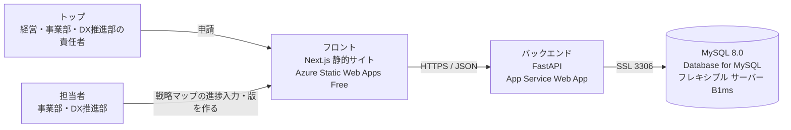
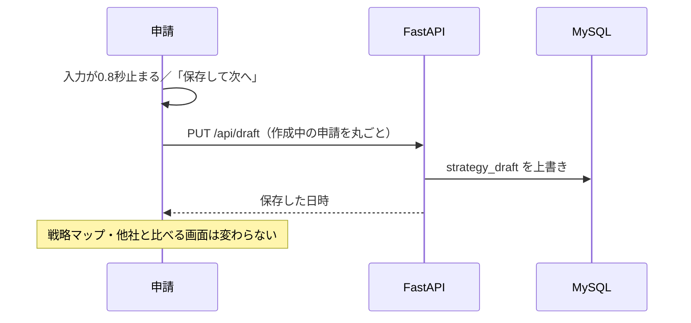
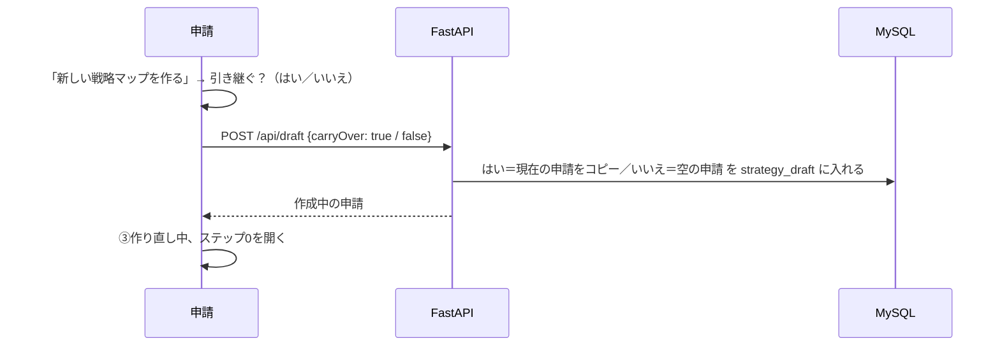
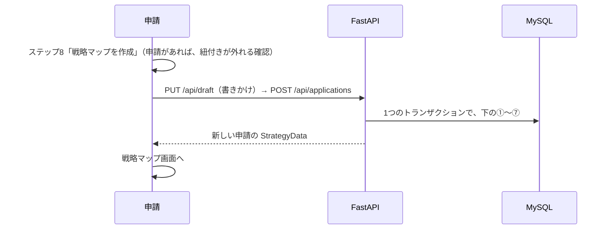
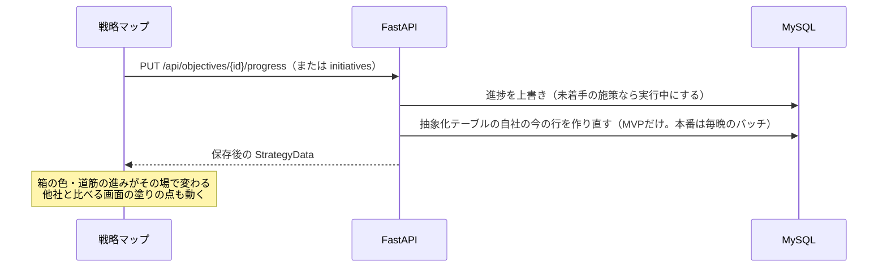
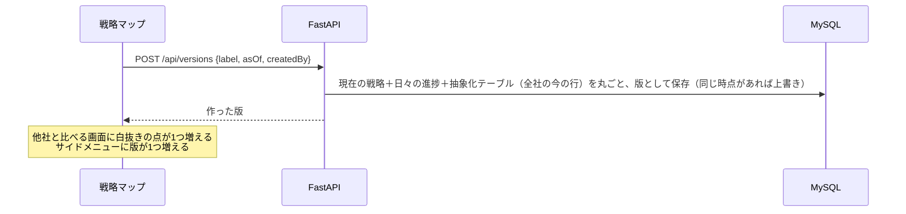
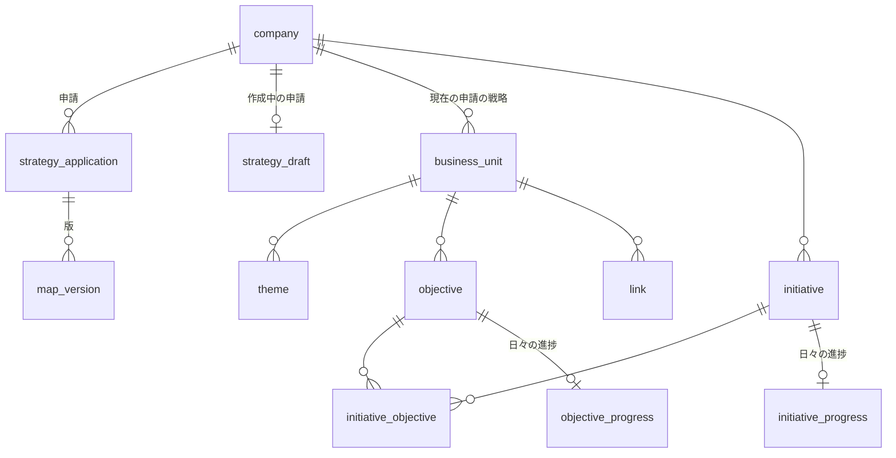

# ミチスジ　システム設計書 v0.4

2026-11-20　作成：服部

この文書は、ミチスジのシステムの設計書です。どの画面で誰が何を入力し、それがどのAPIでバックエンドに届き、DBのどこに保存され、どう返ってきて画面に出るかを書きます。Azureの各リソースの設定もここに書きます。

申請の問いの中身（BSC・戦略マップ・IPAに沿った問いの立て方）は `ミチスジ_質問設計書_v0.1_20261120.md` と `ミチスジ_戦略マップ・申請書_設計書_v0.4_20261115.md` のとおりで、この文書では変えません。変えるのは、項目の名前（「基準」→「今（申請時点）」）と施策の状態の選択肢だけです。

v0.3（2026-11-19）は `旧版` フォルダにあります。v0.3のあとにコードで足したもの（申請時点の状態、出発点、抽象化テーブル）も、この版に入れています。

---

## 0. 前提と、この版で決めたこと

### 0-1 前提

- 今回はMVP（最終発表のデモと展示用）。本番運用はしない
- 会社は1社だけ（架空の「テクゼロン株式会社」）。ログインはなし（将来はGビズID連携の想定）
- 他社は、抽象化テーブルに入れたダミー（41社・117事業）
- 画面の計算（指標の動き、道筋の進み、DXの段階）はフロントの `logic.ts` で行う。抽象化テーブルに抜き出すときだけ、バックエンドの `open_data.py` が同じ計算をする

### 0-2 この版で決めたこと（v0.3からの変更）

| No | 決めたこと | v0.3まで |
|---|---|---|
| 1 | **戦略は「申請」ごとに持つ。** 申請で戦略を作り直したら、新しい申請の戦略マップになる。前の申請の進捗は引き継がない。申請は日付で呼ぶ（例：2026年11月20日の申請） | 戦略は1つで、申請の保存のたびに上書き |
| 2 | **申請は、出したあとは表示だけにする。** 直すときは「新しい戦略マップを作る」から作り直す（前回の内容を引き継ぐか、空から作るかを選ぶ） | いつでも入力でき、0.8秒ごとに戦略を上書き |
| 3 | **申請の書きかけは「作成中の申請」に保存する。** 動いている戦略マップは、作成ボタンを押すまで変わらない | 書きかけがそのまま戦略マップに出る |
| 4 | **「版」＝戦略マップの進捗を、四半期の末などの断面として残したもの。** 申請の中で第1版・第2版…と数える。第1版は作成時点で自動。ふだんは日々の進捗をちびちび上書きし、断面を残したいときに版を作る | 「確定版」。会社に付く |
| 5 | **過去は、どの画面も左のサイドメニューから選んで見る（見るだけ）。** 入力・版を作る・作り直しは「現在」だけ。どの画面も、最初は現在を出す | なし |
| 6 | 「戦略マップを作成」ボタンは申請のステップ8だけに置く。ステップ0〜7は「保存して前へ」「保存して次へ」 | 「入力内容で戦略マップを表示」が全ステップに出ていた |
| 7 | **指標の「基準」をやめて「今（申請時点）」にする。** 作った直後の戦略マップの今の値は、申請時点の値。進みは「申請時点の今 → 目標」の何%まで来たかで出す | 「基準（申請時点）」。作った直後は今の値が空で「未測定」 |
| 8 | **施策の状態は「未着手」「実行中」の2つにする。** 検討中・試行中・中止はなくす。未着手の施策に担当者が進捗を入れたら、自動で実行中になる。やめる施策は、戦略マップを作り直して外す | 検討中・試行中・実行中・中止の4つ |
| 9 | **他社と比べる画面の自社の点は、日々の進捗のそのままの値（塗りの点）。** 版は固定の点（白抜き）として残り、版を作るたびに1つ増える | 確定版だけで点を描く |
| 10 | 戦略マップの「表示する時点（現在／直近の確定）」と「〇〇から変わったこと」はなくす（過去はサイドメニューから見る） | あり |
| 11 | 他社と比べる画面のマス目を、画面の横いっぱいに広げて一番上に置く。参加企業の集計の画面は今の大きさのまま | 2列の左半分 |
| 12 | **デモを初期状態に戻すのは、右上のロゴから。** 戻すと、戦略マップがなく、申請が全部入力済みの「初めての入力」の状態になる | 確定のポップアップの中のボタン。戻すとダミーの戦略マップと進捗が入った状態 |
| 13 | 抽象化テーブルの今の行は、日々の進捗から作る（本番は毎晩のバッチ。企業が増えたら四半期に1回でもよい。MVPは進捗を保存するたびに自社の行を作り直す）。**版を作るときは、その時点の抽象化テーブルを断面として一緒に残す**（過去の他社比較・集計に使う） | 最新の確定版から作る。過去は残さない |

---

## 1. 全体の構成と、Azureの設定

### 1-1 構成



| 部分 | 技術 | Azureのリソース | プラン |
|---|---|---|---|
| フロント | Next.js 16（静的エクスポート）＋TypeScript | Static Web Apps | Free |
| バックエンド | Python 3.12、FastAPI、SQLAlchemy 2.0、PyMySQL | App Service（Web App、Linux）`michisuji-api` | Tech0運営側が作ったApp Serviceプラン（B2相当）の中に作成（2026-11-19に変更。当初はB1を新しく作る案だった） |
| DB | MySQL 8.0、文字コード utf8mb4 | Database for MySQL フレキシブル サーバー `michisuji-db` | Burstable B1ms、20GiB |

Web App と MySQL は同じ地域（Japan East）にそろえる。Static Web Apps は世界中から配信されるので、地域の影響はない。

### 1-2 フロント：Static Web Apps

| 項目 | 設定値 |
|---|---|
| 名前 | `wonderful-bush-0251b4200` |
| ソース | GitHub `nishiyan-12-tech0/yonayona-B-dash`、ブランチ `main` |
| ビルドの設定 | `app_location: "/frontend"`、`output_location: "out"`、`api_location: ""` |
| API の場所 | ワークフローの「Build And Deploy」に環境変数 `NEXT_PUBLIC_API_BASE_URL: https://<Web Appの既定ドメイン>` を書く。静的エクスポートなので、ビルドのときにこの値が画面に埋め込まれる |

### 1-3 バックエンド：App Service（Web App）

| 場所 | 項目 | 設定値 |
|---|---|---|
| 構成 → 全般設定 | スタートアップ コマンド | `gunicorn -w 2 -k uvicorn.workers.UvicornWorker --bind 0.0.0.0:8000 --chdir backend app.main:app` |
| 同上 | Always On | オン |
| 同上 | HTTPS のみ／最小 TLS | オン／1.2 |
| 監視 → 正常性チェック | パス | `/api/health` |
| API → CORS | （触らない） | CORSはFastAPI側で設定する |

アプリ設定（環境変数）

| 名前 | 値 |
|---|---|
| `DB_HOST` | `michisuji-db.mysql.database.azure.com` |
| `DB_PORT` / `DB_NAME` | `3306` / `michisuji` |
| `DB_USER` / `DB_PASSWORD` | MySQLの管理者ユーザー名・パスワード |
| `CORS_ORIGINS` | `https://wonderful-bush-0251b4200.<番号>.azurestaticapps.net,http://localhost:3000` |
| `COMPANY_ID` | `1` |
| `SCM_DO_BUILD_DURING_DEPLOYMENT` | `true` |

### 1-4 DB：Database for MySQL フレキシブル サーバー

| 項目 | 設定値 |
|---|---|
| コンピューティングとストレージ | Burstable `Standard_B1ms`、20GiB、自動拡張オフ |
| 高可用性・geo 冗長バックアップ | オフ |
| バックアップの保持期間 | 7日（20GiBまで追加料金なし） |
| ネットワーク | パブリック アクセス。「Azure 内の任意の Azure サービスにこのサーバーへのパブリック アクセスを許可する」をオン。手元のPCのIPを許可 |
| データベース | `michisuji`、`utf8mb4` / `utf8mb4_0900_ai_ci` |
| サーバー パラメーター | `require_secure_transport` ON、`time_zone` `+09:00` |

### 1-5 料金と、発表後の止め方

| リソース | 発表後 |
|---|---|
| Static Web Apps Free | そのまま（無料） |
| Web App | Tech0運営側のプランの中なので、自分では止めない。不要になったら Web App を削除 |
| MySQL B1ms | 「停止」で計算の料金が止まる（ストレージ分は残る） |

---

## 2. ことばの決まり

| ことば | 意味 | 呼び方 |
|---|---|---|
| 申請 | トップが戦略を描いたもの。作り直すたびに増える。1つの申請から1つの戦略マップができる | 日付（例：2026年11月20日の申請） |
| 現在の申請 | いちばん新しい申請。担当者が進捗を入力できるのは、この申請の戦略マップだけ | 〇〇の申請（現在） |
| 過去の申請 | 新しい申請に置き換わった申請。申請・戦略マップ・版を見るだけ | |
| 作成中の申請 | トップが書きかけの申請。「戦略マップを作成」を押すと、新しい申請になる | 作成中 |
| 日々の進捗 | 担当者が戦略マップで、ふだんちびちび書いていく進捗。いつでも上書きできる。戦略マップと他社と比べる画面（塗りの点）にすぐ出る | 現在 |
| 版 | ある時点（四半期の末など）の戦略マップと進捗を、断面として残したもの。申請の中で数える。他社と比べる画面の白抜きの点になる | 第1版（作成時点）、第2版（2026年12月末）… |
| 第1版（作成時点） | 申請から戦略マップを作ったときに自動で作る版。消せない | |
| 置き換え時点の版 | 新しい申請を作ったとき、前の申請に自動で作る最後の版。消せない（前の申請の最後の進捗を残すため） | 第n版（置き換え時点） |
| 今（申請時点） | 申請で入力する、申請したときの指標の値。進みの起点（v0.3までの「基準」） | |
| 今の値 | 担当者が戦略マップで入力する、指標の今の値。入力するまでは、今（申請時点）と同じ | |
| 抽象化テーブル | 各社の戦略から、事業ごとの段階・進み・件数だけを抜き出したもの。他社と比べる画面と参加企業の集計は、ここだけを見る（本番は別のオープンなDB。MVPは同じDBの中の1つのテーブル） | |
| 抽象化の断面 | 版を作ったときに残す、その時点の抽象化テーブル（全社の行）。過去の他社比較・集計に使う | |

---

## 3. 入力の役割分担（どこで・誰が・何を）

### 3-1 申請（トップ）

戦略の中身すべて。ステップ0〜8の並び・問い・説明は質問設計書のとおりで、変えない。

| ステップ | 入力する項目 | v0.4での変更 |
|---|---|---|
| 0 会社と事業 | 全社の財務目標（目標・指標・今（申請時点）・目標・期限）、対象にする事業（事業名・業種・売上割合・責任者） | 「基準」→「今（申請時点）」 |
| 1 財務の目標 | 今との差、差の埋め方、事業の財務目標 | 同上 |
| 2 顧客への価値 | 対象の顧客、顧客価値提案の類型、将来の提供価値、顧客の成果目標 | 同上 |
| 3 戦略テーマと業務 | 戦略テーマ（1〜3個）、変える業務、事業側で確認した人・日付 | 同上 |
| 4 必要な力と施策 | 学習と成長の目標、施策（施策名・付ける目標・主担当・デジタル・IPA項目・施策の指標・今（申請時点）・目標・**申請時点の状態**） | 「基準」→「今（申請時点）」。申請時点の状態の選択肢は「未着手」「実行中」の2つ |
| 5 つながりと検証 | 元の目標→先の目標、理由、成り立つ条件、次に確かめること、時期 | なし |
| 6 実行の準備 | 実行条件の確保、検証と次の判断日、決めた場 | なし |
| 7・8 | 入力なし（確認だけ） | ステップ8に「戦略マップを作成」 |

### 3-2 戦略マップ（担当者）

現在の申請の「現在」を表示しているときだけ入力できる。日々の進捗はどれも上書きで、何度でも書き換えられる。

| どこから | 入力する項目 | 必須 | 保存先 |
|---|---|---|---|
| 目標の詳細 →「進捗を入力」 | 指標の今の値 | ○ | `objective_progress` |
| | 測った日 | ○ | 同上 |
| | 動かなかった・下がった理由（施策が遅れた／施策は進んだが指標が動かない／外部環境が変わった／測れていない／その他） | 横ばい・悪化のときだけ○ | 同上 |
| | メモ | | 同上 |
| | 入力した人 | ○ | 同上 |
| 施策の詳細 →「進捗を入力」 | 効果の検証（未測定／確認中／効果あり／効果なし） | ○ | `initiative_progress` |
| | やったこと | ○ | 同上 |
| | 結果・わかったこと | | 同上 |
| | 施策の指標の今の値（指標があるときだけ） | | 同上 |
| | 入力した人 | ○ | 同上 |
| 戦略マップの上部 →「版を作る」 | 版の時点（年と四半期の末）、作った人 | ○ | `map_version` |

- 施策の状態（未着手／実行中）は、ポップアップでは選ばない。**未着手の施策に進捗を保存したら、実行中にする**（実行中から未着手には戻らない）
- 未着手の施策の効果の検証は「未測定」のまま

---

## 4. 画面ごとの変更

### 4-1 全画面の共通

**右上のロゴ**：押すと「デモを初期状態に戻す」の確認を出す（4-7）。見た目はロゴのまま（ボタンらしくはしない。展示の係が使う）。

**左のサイドメニュー（過去を見る）**

- 各画面の左上に「表示中：{今出しているもの}　🕘 過去を見る」を置く。押すと、左からサイドメニューが出る
- メニューには、一番上に現在、その下に過去を新しい順に並べる。押すと画面がそれに変わり、メニューは閉じる。メニューの外を押すか「×」「Esc」でも閉じる
- 過去を表示しているあいだは、画面の上に「{〇〇}を表示しています（見るだけ）　［現在に戻す］」を出す。入力・保存・版を作る・作り直しのボタンは出さない
- 4画面とも同じ部品（`HistoryDrawer`）を使う。画面を移っても、選んだ過去は引き継がない（どの画面も、開いたときは現在）
- 同じ日に申請がほかにもあるとき（デモで何度も作り直すとき）は、申請の名前に時刻も付ける（例：2026年11月20日 14:05の申請）

| 画面 | メニューに並ぶもの（新しい順） |
|---|---|
| 申請 | 作成中（作り直し中のときだけ）／2026年11月21日の申請（現在）／2026年11月20日の申請… |
| 戦略マップ | 申請ごとのまとまりの中に、現在（日々の進捗。現在の申請だけ）と版を並べる（下の図） |
| 他社と比べる | 戦略マップと同じ |
| 参加企業の集計 | 現在／版を作った時点（どの申請の版かは問わず、時点の新しい順） |

```
戦略マップ／他社と比べる のメニュー
  2026年11月21日の申請（現在）
    現在（日々の進捗）　← 入力できるのはここだけ
    第2版　2026年12月末
    第1版　作成時点（2026年11月21日）
  2026年11月20日の申請
    第3版　置き換え時点（2026年11月21日）
    第2版　2026年9月末
    第1版　作成時点（2026年11月20日）
```

### 4-2 申請

**3つの状態**

| 状態 | いつ | 画面 | ボタン |
|---|---|---|---|
| ① 初めての入力 | 申請がまだない（初期状態に戻した直後もここ） | 入力できる。デモでは全項目が入った状態で始まる | 0〜7：「保存して前へ」「保存して次へ」。8：「戦略マップを作成」 |
| ② 表示 | 申請があり、作成中の申請がない | 現在の申請を、見るだけで出す（入力欄は文字の表示。行の追加・削除ボタンは出さない） | 「前へ」「次へ」。上部に「新しい戦略マップを作る」 |
| ③ 作り直し中 | 申請があり、作成中の申請がある | 作成中の申請を、入力できる形で出す | 0〜7：「保存して前へ」「保存して次へ」。8：「戦略マップを作成」。上部に「作り直しをやめる」 |

- サイドメニューで過去の申請を選ぶと、その申請を見るだけで出す。「新しい戦略マップを作る」は出さない
- 最初に出すのは、③なら作成中、②なら現在の申請

**「新しい戦略マップを作る」を押したとき**

> 前回の申請内容を引き継ぎますか？
> ［はい：前回の内容から直す］［いいえ：空の申請から作る］［やめる］

- はい：現在の申請をコピーして、作成中の申請にする。今（申請時点）の値と施策の申請時点の状態には、戦略マップに入力された最新の値を入れる（新しい申請の「申請時点」は今なので）。行のIDもそのまま引き継ぐ（進捗は引き継がないので、IDが同じでも紐付きはない）
- いいえ：空の申請（全社の財務目標の枠だけ。事業は0件）から始める
- どちらも、ステップ0を開く

**「作り直しをやめる」を押したとき**

> 作成中の申請を捨てて、現在の申請に戻しますか？　［捨てる］［やめる］

**「戦略マップを作成」を押したとき**

- 申請がまだない（①）：確認なしで作る
- 申請がある（③）：次の確認を出す

> 新しい戦略マップを作ると、戦略マップ画面で入力した進捗（指標の今の値、施策の状態・やったこと）との紐付きがすべて外れ、1からになります。今の申請・戦略マップ・版は、左の「過去を見る」からいつでも見られます。よろしいですか？　［作成する］［やめる］

- 作る前に、事業が1つ以上あるかを確かめる。なければ「ステップ0で事業を追加してください」を出して作らない
- 作ったら、戦略マップ画面へ移る

**保存**

| 操作 | 処理 |
|---|---|
| 入力 | 入力が0.8秒止まったら、作成中の申請に保存する（今までどおり） |
| 「保存して前へ」「保存して次へ」、左のステップ一覧 | 書きかけをすぐ保存してから移る。保存に失敗したら移らずに「保存できませんでした」を出す |
| 右上の表示 | 「保存中…」「保存しました」「保存できませんでした」（保存先は作成中の申請） |

**指標の欄の名前**：「指標／基準（申請時点）／目標／期限」→「指標／今（申請時点）／目標／期限」。施策の表の「基準」も「今（申請時点）」にする。

### 4-3 戦略マップ

| 部分 | 変更 |
|---|---|
| 過去を表示中 | サイドメニューで選んだ版の戦略マップと進捗を出す。「進捗を入力」「版を作る」は出さない |
| 「表示する時点（現在／直近の確定）」 | なくす（サイドメニューに置き換え） |
| 「〇〇から変わったこと」 | なくす |
| 作った直後 | 指標の今の値＝今（申請時点）なので「未測定」ではなく、指標の動きは「申請時点のまま」、進みは0%。担当者が値を入れると「改善・横ばい・悪化」になる。道筋の進みも0から始まる。施策は申請時点の状態（未着手・実行中）で出る |
| 申請がまだないとき | 「まだ戦略マップがありません。『申請』のステップ8で『戦略マップを作成』を押すと、ここに出ます。」と、申請へのリンクだけを出す |
| 詳細の「基準」 | 「申請時点」にする |
| 上部の「進捗を確定」 | 「版を作る」にする |

**「進捗を入力」ボタンが出る条件**

| ボタン | 出るとき |
|---|---|
| 目標の「進捗を入力」 | 現在を表示していて、その目標に指標がある（全項目必須なので、指標がない目標は基本的にない） |
| 施策の「進捗を入力」 | 現在を表示している（未着手でも出る。保存すると実行中になる） |
| 「版を作る」 | 現在を表示している |

**「版を作る」のポップアップ**（今の「進捗を確定」のポップアップを直す）

- 説明：「今の進捗を、この時点の版として残します。他社と比べる画面に固定の点が1つ増えます。ふだんの進捗の入力は、版を作らなくても戦略マップと他社と比べる画面に出ます。」
- 版の時点（年と四半期の末）、作った人
- この申請の版の一覧（第n版・時点・作った日・作った人）。各行に「削除」（作成時点・置き換え時点の版は消せない）
- 同じ時点の版がすでにあれば「{時点}の版を上書きします」と出してから上書きする（今回だけ）
- 「デモを初期状態に戻す」ボタンは消す（ロゴへ移す）
- 作ったら「第{n}版を作りました。他社と比べる画面に固定の点を追加しました」を出す

### 4-4 他社と比べる

**現在を表示しているとき**

| 点 | 中身 |
|---|---|
| 塗りの点 | 現在の申請の、日々の進捗のそのままの値。進捗を保存するたびに動く |
| 白抜きの点 | 現在の申請の版（第1版を含む）。新しい順に最大5つ。古いほど薄くする |
| 線 | 同じ事業の点を、古い順につなぐ（軌跡）。最後は塗りの点につながる |
| 他社 | 抽象化テーブルの、他社の今の行（本番は毎晩のバッチの結果） |

**過去の版を表示しているとき**

| 点 | 中身 |
|---|---|
| 塗りの点 | 選んだ版 |
| 白抜きの点・線 | 同じ申請の、それより前の版 |
| 他社 | 選んだ版を作ったときに残した、抽象化の断面 |

- 点を出すのは、表示している申請のものだけ。前の申請の点はつながない（道筋の進みは、その申請の戦略の中で見るものなので）
- 凡例：「塗り＝{表示しているもの}／白抜き＝それより前の版」
- 点にマウスを乗せたとき：「{事業名}（現在）」「{事業名}（第{n}版 {時点}）」
- MVPの他社はダミーが1組だけなので、過去の版を選んでも他社の分布は変わらない（自社の点だけが変わる）

**レイアウト**

```
┌──────────────────────────────────────────────┐
│ 道筋のどこまで進んだか × DXの段階（横いっぱい） │
└──────────────────────────────────────────────┘
┌───────────────────────┐┌─────────────────────┐
│ 自社の事業              ││ 項目ごとの比較        │
└───────────────────────┘└─────────────────────┘
┌──────────────────────────────────────────────┐
│ 道筋にあるDX（IPAの7項目）                      │
└──────────────────────────────────────────────┘
```

- マス目の図は、今の最大幅（700px）の固定を外し、横いっぱいに広げる。マスの高さと文字も大きくする
- 図の部品（`GridChart`）に大きさの指定（大・小）を足す。他社と比べる画面は大、参加企業の集計は小（今のまま）
- 「自社の事業」「項目ごとの比較」「道筋にあるDX」は、表示しているもの（現在または選んだ版）の値で出す

### 4-5 参加企業の集計

- 画面の中身は変えない。現在は、抽象化テーブルの全社の今の行から集計する
- サイドメニューで版の時点を選ぶと、その版を作ったときに残した抽象化の断面から集計する

### 4-6 進捗を入力するポップアップ

- 目標：今までどおり。「基準」の文字は「申請時点」にする
- 施策：「実行の状態」の選択をなくす。効果の検証・やったこと・結果・施策の指標の今の値・入力した人を入れる

### 4-7 デモを初期状態に戻す

> デモを初期状態に戻しますか？　申請・戦略マップ・進捗・版をすべて消し、申請が入力済みの状態に戻します。　［戻す］［やめる］

- 戻したあとは、申請の①（ステップ0）を開く

---

## 5. 処理の流れ

### 5-1 画面を開いたとき

| 画面 | 呼ぶAPI | 出すもの |
|---|---|---|
| 全画面 | `GET /api/applications` | サイドメニューの中身（申請と版の一覧） |
| 申請 | `GET /api/draft`、（②のとき）`GET /api/applications/{現在の申請}` | 3つの状態のどれか（4-2） |
| 戦略マップ | `GET /api/strategy` | 現在の申請と日々の進捗。過去の版を選んだら `GET /api/versions/{id}` |
| 他社と比べる | `GET /api/strategy`、`GET /api/applications/{id}/versions`、`GET /api/peers` | 4-4。過去の版を選んだら `GET /api/peers?version={id}` |
| 参加企業の集計 | `GET /api/meti/summary` | 4-5。過去の時点を選んだら `GET /api/meti/summary?version={id}` |

### 5-2 申請の入力（作成中の申請への保存）



### 5-3 新しい戦略マップを作る（作り直しを始める）



### 5-4 戦略マップを作成



① 現在の申請があれば、その申請に「置き換え時点」の版を自動で作り（今の戦略＋日々の進捗＋抽象化の断面）、申請に `replaced_at` を付ける
② 会社の戦略のテーブル（事業・テーマ・目標・つながり・施策・施策と目標の紐づけ）と、進捗のテーブル（`objective_progress`・`initiative_progress`）の行を全部消す
③ 作成中の申請の中身を、戦略のテーブルに入れる
④ 施策ごとに進捗の行を作る。状態は申請時点の状態（未着手・実行中）、効果の検証は未測定。目標の進捗の行は作らない（今の値は今（申請時点）を出す）
⑤ `strategy_application` に新しい申請の行を足す（出した日時、申請のJSON）
⑥ 抽象化テーブルの自社の今の行を作り直す
⑦ 第1版（作成時点）を作る（戦略＋進捗＋抽象化の断面）。作成中の申請を消す

### 5-5 進捗の入力（担当者）



### 5-6 版を作る



### 5-7 デモを初期状態に戻す

`POST /api/demo/reset`：会社の申請・戦略・進捗・版・作成中の申請・抽象化テーブルの自社の行を全部消し、初期データ（全項目入力済みの申請）を作成中の申請に入れる。

---

## 6. API設計

### 6-1 共通

| 項目 | 内容 |
|---|---|
| URL | `https://<Web Appの既定ドメイン>/api/...` |
| 形式 | JSON（UTF-8）。項目名はフロントの型（`types.ts`）と同じ |
| 会社 | 環境変数 `COMPANY_ID` の会社に固定 |
| 認証 | なし（MVP） |
| エラー | `{"detail": "日本語の説明"}`。入力の誤り422、見つからない404、状態が合わない409、DBの障害500 |

### 6-2 一覧

| No | メソッド・パス | 使う画面 | 内容 | v0.3から |
|---|---|---|---|---|
| A-1 | `GET /api/health` | 監視 | DBにつながるか | そのまま |
| A-2 | `GET /api/strategy` | 戦略マップ・他社と比べる | 現在の申請の戦略と日々の進捗。申請がなければ `application: null`、事業は空 | 変更 |
| A-3 | `GET /api/applications` | 全画面（サイドメニュー） | 申請の一覧と、申請ごとの版の一覧（新しい順） | 新規 |
| A-4 | `GET /api/applications/{id}` | 申請 | その申請の内容（申請のJSON） | 新規 |
| A-5 | `POST /api/applications` | 申請 | 作成中の申請から、新しい申請と戦略マップを作る（5-4） | 新規 |
| A-6 | `GET /api/draft` | 申請 | 作成中の申請。なければ `null` | 新規 |
| A-7 | `PUT /api/draft` | 申請 | 作成中の申請を上書き | 新規 |
| A-8 | `POST /api/draft` | 申請 | 作り直しを始める `{carryOver: true/false}`。すでにあれば409 | 新規 |
| A-9 | `DELETE /api/draft` | 申請 | 作り直しをやめる。申請がない（①）ときは409 | 新規 |
| A-10 | `PUT /api/objectives/{id}/progress` | 戦略マップ | 目標の進捗を上書き | そのまま（抽象化テーブルの作り直しを足す） |
| A-11 | `PUT /api/initiatives/{id}/progress` | 戦略マップ | 施策の進捗を上書き。状態は送らない（未着手なら実行中にする） | 変更 |
| A-12 | `GET /api/applications/{id}/versions` | 他社と比べる | その申請の版（戦略マップのJSONつき）。新しい順に最大6つ | 変更（旧 `GET /api/strategy/confirmed`） |
| A-13 | `POST /api/versions` | 戦略マップ | 現在の申請に版を作る | 変更（旧 `POST /api/confirmations`） |
| A-14 | `GET /api/versions/{id}` | 戦略マップ | その版の戦略マップ（`StrategyData`） | 新規 |
| A-15 | `DELETE /api/versions/{id}` | 戦略マップ | 版を1つ消す。作成時点・置き換え時点の版、過去の申請の版は409 | 変更（旧 `DELETE /api/confirmations/{id}`） |
| A-16 | `GET /api/peers[?version={id}]` | 他社と比べる | 他社の集計。版を指定したら、その版の抽象化の断面から | 変更 |
| A-17 | `GET /api/meti/summary[?version={id}]` | 参加企業の集計 | 全社の集計。版を指定したら、その版の抽象化の断面から | 変更 |
| A-18 | `POST /api/batch/open-data` | （手動） | 抽象化テーブルの今の行を全社ぶん作り直す（本番の毎晩のバッチにあたる） | 変更（日々の進捗から） |
| A-19 | `POST /api/demo/reset` | 全画面（ロゴ） | 初期状態に戻す（5-7） | 変更 |
| 廃止 | `PUT /api/strategy`、`POST /api/strategy/versions`、`POST /api/strategy/submit`、`GET /api/confirmations` | | 作成中の申請（A-7）、作成（A-5）、申請の一覧（A-3）にまとめる | |

### 6-3 返す形

```ts
/** 版 */
export interface MapVersionMeta {
  id: number;
  no: number;           // 第何版か
  label: string;        // 時点（例：2026年12月末、作成時点、置き換え時点）
  asOf: string;         // 時点の日付（並び順に使う）
  kind: "start" | "manual" | "end"; // 作成時点／手で作った／置き換え時点
  createdBy: string;
  createdAt: string;
}
/** 申請 */
export interface ApplicationMeta {
  id: number;
  submittedAt: string;       // 出した日時（「2026年11月20日の申請」の日付）
  replacedAt: string | null; // 置き換わった日時（現在の申請は null）
  current: boolean;
  versions: MapVersionMeta[]; // 新しい順
}
// StrategyData に足す
//   application: { id: number; submittedAt: string } | null
// StrategyData からなくす
//   snap、diffs、Objective.prev、Initiative.prev（時点の切り替えがなくなるため）

// A-6 の返す形
//   { body: StrategyData, savedAt: string, carryFrom: number | null } | null
// A-12 の返す形
//   { versions: [{ ...MapVersionMeta, data: StrategyData }] }
```

- 目標の `cur`：進捗の行があればその値、なければ `base`（今（申請時点））を入れて返す
- 施策の `exec`：0＝未着手、1＝実行中

### 6-4 A-11 PUT /api/initiatives/{id}/progress

```json
{ "verify": 1, "kpiCur": "2,300台", "did": "連携対象を組立ラインの全設備に広げた", "result": "欠損なし率が91%→95%", "author": "DX推進部 佐藤" }
```

- `verify` `did` `author` は必須。`verify` は0〜3
- 保存のとき、`exec` が0（未着手）なら1（実行中）にする

### 6-5 A-13 POST /api/versions

```json
{ "label": "2026年12月末", "asOf": "2026-12-31", "createdBy": "DX推進部長" }
```

- 現在の申請の戦略と日々の進捗で `StrategyData` を組み立て、抽象化テーブルの全社の今の行と一緒に版として保存する
- 同じ申請に同じ `label` の版があれば上書きする（今回だけ）。番号は変えない

---

## 7. 時点の扱い

| | 日々の進捗 | 版 | 申請 |
|---|---|---|---|
| 入れる人 | 担当者 | 担当者（本来は責任者） | トップ |
| いつ | いつでも | 四半期・半年ごと（断面を残したいとき） | 戦略を作り直したとき |
| 書き換え | いつでも上書き | 同じ時点をもう一度作ると上書き（今回だけ）。削除もできる（作成時点・置き換え時点以外） | 出したあとは書き換えない（作り直すと新しい申請になる） |
| 出る画面 | 戦略マップ、他社と比べる（塗りの点） | 他社と比べる（白抜きの点）、全画面のサイドメニュー | 申請、全画面のサイドメニュー |
| 抽象化テーブル | 今の行になる（本番は毎晩、MVPは保存のたび） | 版を作るとき、その時点の全社の行を断面として残す | 現在の申請だけを抜き出す |

---

## 8. DB設計

### 8-1 テーブルのつながり



- 戦略のテーブル（事業・テーマ・目標・つながり・施策・紐づけ）と進捗のテーブルには、**現在の申請だけ**を入れる
- 過去の申請は、`strategy_application` と `map_version` にJSONで丸ごと残る
- 指標の値は「月42件」のような単位つきの文字で持つ（計算はフロントの `num()`）

### 8-2 新しく足すテーブル

**strategy_application（申請）**

| 列 | 型 | 内容 |
|---|---|---|
| id | BIGINT 自動採番 PK | |
| company_id | INT FK | |
| submitted_at | DATETIME | 出した日時 |
| replaced_at | DATETIME NULL | 置き換わった日時（現在の申請は NULL） |
| body | JSON | 申請の内容（`StrategyData`） |

**map_version（版）**：今の `progress_confirmation` を置き換える

| 列 | 型 | 内容 |
|---|---|---|
| id | BIGINT 自動採番 PK | |
| company_id | INT FK | |
| application_id | BIGINT FK | どの申請の版か |
| no | INT | 第何版か。`(application_id, no)` で一意 |
| label | VARCHAR(50) | 時点の名前（例：2026年12月末）。`(application_id, label)` で一意 |
| as_of | DATE | 時点の日付 |
| kind | ENUM('start','manual','end') | 作成時点／手で作った／置き換え時点 |
| body | JSON | その時点の戦略＋進捗（`StrategyData`） |
| open_body | JSON | その時点の抽象化テーブルの全社の行（抽象化の断面） |
| created_by | VARCHAR(100) | 作った人 |
| created_at | DATETIME | 作った日時（上書きしたら新しい日時） |

**strategy_draft（作成中の申請）**：会社ごとに1行

| 列 | 型 | 内容 |
|---|---|---|
| company_id | INT PK・FK | |
| body | JSON | 作成中の申請（`StrategyData`） |
| carry_from | BIGINT NULL | 引き継いだ申請のID（空から作ったときは NULL） |
| updated_at | DATETIME | 最後に保存した日時 |

### 8-3 変えるテーブル

| テーブル | 変更 |
|---|---|
| `objective` | `base` の意味を「今（申請時点）」にする（列の名前はそのまま） |
| `initiative` | `exec0 TINYINT` を足す（申請時点の状態。0＝未着手、1＝実行中）。`base` の意味は objective と同じ |
| `initiative_progress` | `exec` は0＝未着手、1＝実行中だけにする |
| `open_business_snapshot` | 今の行だけを持つ（1社の1事業で1行のまま）。抜き出し元を「最新の確定版」から「現在の申請の日々の進捗」にする。`as_of_label` は「現在」、`as_of` は抜き出した日 |

### 8-4 なくすテーブル

| テーブル | 理由 |
|---|---|
| `progress_confirmation` | `map_version`（版）に置き換える |
| `strategy_version` | `strategy_application`（申請）にまとめる |
| `change_note` | 「〇〇から変わったこと」をなくすため |

`deleted_at`（削除した印）は、1つの申請の中で申請を書き換えることがなくなるので使わなくなる。列は残す。

### 8-5 今のDBからの移し方

テーブルの作りが変わるので、デプロイのあとに**テーブルを全部作り直す**（MVPなので、中のデータは初期データに戻ってよい）。起動時に、スキーマの版（`schema_meta` テーブルの値）が古ければ、全部消して作り直す。

---

## 9. 初期データ

| 初期データ | 入れる先 |
|---|---|
| `seed_data.json` の会社 | `company` |
| `seed_data.json` の戦略（全社の目標・事業・テーマ・目標・つながり・施策） | `strategy_draft`（作成中の申請）だけ。全項目入力済み。目標・施策の今（申請時点）＝ `base` には、ダミーの「現在」の値（なければ今の `base`）を入れる。施策の申請時点の状態は、今の `exec` を「試行中・実行中＝実行中、それ以外＝未着手」にして入れる |
| ダミーの「現在」「2026年3月末」の値、変わったこと | 使わない |
| 他社のダミー（41社・117事業） | `open_business_snapshot`（今までどおり） |

- 申請・戦略のテーブル・進捗・版は空。戦略マップは「まだありません」になる
- バックエンドの起動時に、会社のデータがなければ自動でこの状態にする。`python -m app.seed --reset` と画面のロゴ（A-19）でも同じ状態に戻す

---

## 10. バックエンドの作り

```
backend/
├─ app/
│  ├─ main.py         FastAPIの起動、CORS、ルーターの登録、スキーマの版の確認（8-5）
│  ├─ config.py       環境変数の読み込み
│  ├─ db.py           MySQLへの接続（SSL。証明書は certifi）
│  ├─ models.py       テーブルの定義（8章）
│  ├─ schemas.py      APIの入出力の形（types.ts と同じ項目名）
│  ├─ strategy.py     StrategyData の組み立て、作成中の申請、申請の作成（5-4）、進捗、版
│  ├─ open_data.py    抽象化テーブルへの抜き出しと集計（日々の進捗から。版の断面からも集計）
│  ├─ routers/api.py  API（A-1〜A-19）
│  ├─ seed.py         初期データの投入（起動時に自動。--reset あり）
│  └─ seed_data.json  初期データ
├─ sql/schema.sql     テーブルを作るSQL（参考）
└─ requirements.txt
```

---

## 11. デプロイ

| 対象 | 方法 |
|---|---|
| バックエンド | Web App の「デプロイ センター」で GitHub の `main` につないだまま（push すると自動でデプロイ）。一番上の `requirements.txt`（`-r backend/requirements.txt`）と、起動コマンドの `--chdir backend` は今までどおり |
| フロント | Static Web Apps のワークフローのまま（push すると自動でデプロイ） |
| DB | 何もしない。初回起動時に、スキーマの版を見てテーブルを作り直し、初期データを入れる（8-5、9章） |

確認の順番：①`/api/health` が `ok` → ②申請が全項目入力済みで出る → ③ステップ8で作成すると戦略マップが出る → ④進捗を入れると他社と比べる画面の塗りの点が動く → ⑤版を作ると白抜きの点が増え、サイドメニューに版が出る → ⑥「新しい戦略マップを作る」で2つ目の申請を作り、前の申請と版がサイドメニューから見られる → ⑦ロゴで初期状態に戻る

---

## 12. フロントで変わるファイル

| ファイル | 変更 |
|---|---|
| `lib/types.ts` | `ApplicationMeta`・`MapVersionMeta`・`MapVersion`・`Draft`、`application` を足す。`snap`・`diffs` をなくす（`Snap` 型と `prev` は名残りとして残し、使わない） |
| `lib/constants.ts` | `EXEC` を「未着手」「実行中」の2つにする。指標の動きに「申請時点のまま」を足す |
| `lib/logic.ts` | 今の値がなければ `base` を使う。実行中＝`exec === 1`。担当者が入力する前で今＝申請時点なら「申請時点のまま」。時点（`snap`）の引数は残すが、いつも現在 |
| `lib/api.ts` | A-3〜A-9・A-12〜A-17 の関数。廃止したAPIの関数を消す |
| `lib/store.tsx` | 「現在の申請の戦略」と「申請画面で開いているもの（作成中の申請／申請の内容）」を分けて持つ。自動保存の送り先を作成中の申請にする。申請と版の一覧を持つ |
| `components/AppShell.tsx` | ロゴを押すと初期状態に戻す確認を出す |
| `components/HistoryDrawer.tsx`（新規） | 左のサイドメニュー（4-1）と、過去を表示中の帯 |
| `components/GridChart.tsx` | 大きさの指定（大・小）。塗りの点と白抜きの点 |
| `features/entry/EntryView.tsx` | 3つの状態、ボタン、確認、保存して前へ・次へ（4-2） |
| `features/entry/forms.tsx` | 表示だけのときは入力欄を文字にする。「基準」→「今（申請時点）」。申請時点の状態を2択に |
| `features/map/MapView.tsx` | サイドメニュー、時点の切り替えと変わったことをなくす、申請がないときの表示（4-3） |
| `features/map/Panel.tsx` | ボタンの条件（4-3）、「基準」→「申請時点」 |
| `features/map/InitiativeProgressModal.tsx` | 実行の状態の選択をなくす |
| `features/map/ConfirmModal.tsx` | 「版を作る」にする。「デモを初期状態に戻す」を消す |
| `features/compare/CompareView.tsx` | サイドメニュー、レイアウト（4-4）、点の作り方 |
| `features/meti/MetiView.tsx` | サイドメニュー（中身は変えない） |
| `components/Track.tsx` | 時点の文字をなくす |
| `app/globals.css` | サイドメニュー、他社と比べる画面のレイアウト、申請の表示だけのときの見た目 |

---

## 13. 今回やらないこと（次の段階）

- ログインと、トップ・担当者・版を作る責任者の権限分け（今回は誰でも全部入力できる）
- 申請の全項目の必須チェック（今回は、作成のときに事業が1つ以上あるかだけを確かめる）
- 版を書き換え・削除できないようにすること
- 申請どうし、版どうしを並べて比べる画面
- 複数社。毎晩のバッチの自動実行（今回は手動の A-18 と、保存のたびの自社の作り直し）
- 同時に直したときの衝突の検知（後から保存した方が勝つ）
